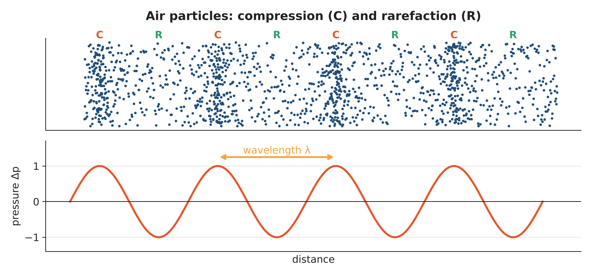
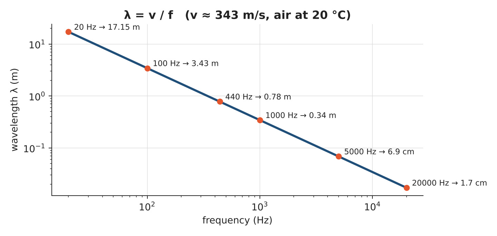
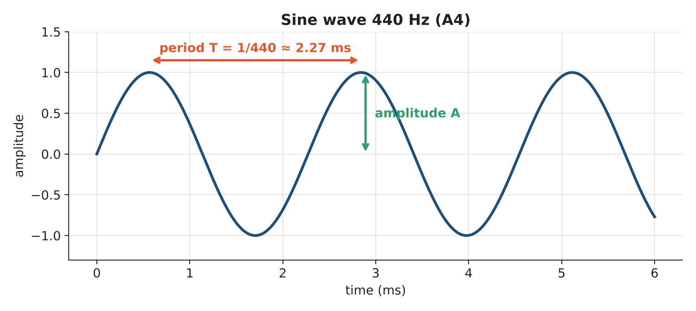
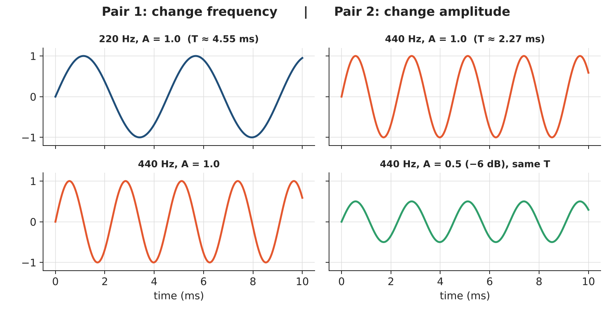
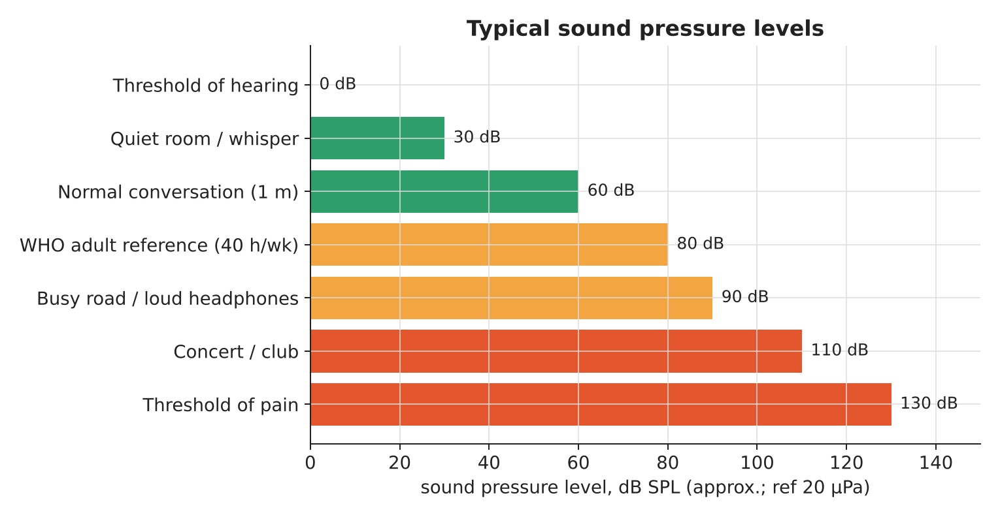
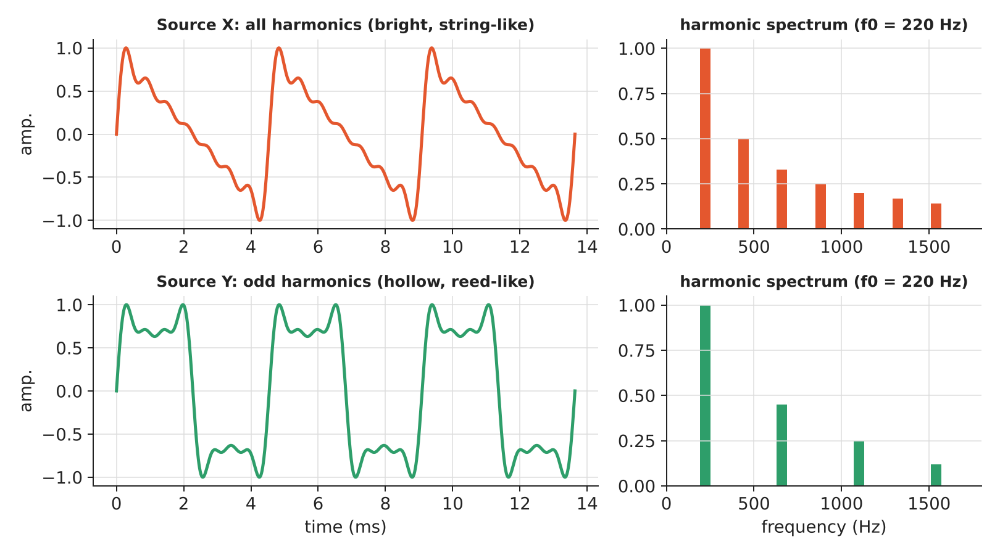
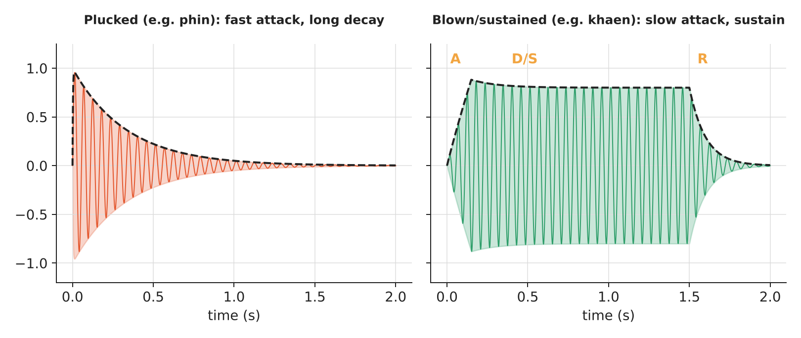

# สัปดาห์ที่ 1: ฟิสิกส์ของเสียงและการฟังเชิงวิเคราะห์

*Physics of Sound and Analytical Listening*

**เอกสารประกอบการสอน IMS2003 การประมวลผลเสียงและสุนทรียศาสตร์ด้านมัลติมีเดีย**

- หลักสูตรวิทยาศาสตรบัณฑิต สาขาวิชาวิทยาการมัลติมีเดียปัญญาประดิษฐ์ พ.ศ. 2569
- วิชาแกน 3(2-2-5) · ชั้นปีที่ 2 ภาคปลาย
- อาจารย์ ดร.เขมวิทย์ จิตตะยโศธร
- คณะเทคโนโลยีสารสนเทศ มหาวิทยาลัยราชภัฏร้อยเอ็ด

---

## แผนบริหารการสอนประจำสัปดาห์ที่ 1

| รายการ | รายละเอียด |
| --- | --- |
| รหัสและชื่อวิชา | IMS2003 การประมวลผลเสียงและสุนทรียศาสตร์ด้านมัลติมีเดีย (Audio and Speech Processing in Multimedia) |
| หัวข้อ | ฟิสิกส์ของเสียงและการฟังเชิงวิเคราะห์ |
| เวลาเรียน | ทฤษฎี 2 ชั่วโมง · ปฏิบัติ 2 ชั่วโมง · ศึกษาด้วยตนเอง 5 ชั่วโมง |
| CLO / PLO ที่เกี่ยวข้อง | CLO1 อธิบายฟิสิกส์ของเสียง A/D conversion และหลัก DSP พร้อมอ่านหลักฐานจากกราฟได้ (PLO1) |
| ความรู้พื้นฐาน | คณิตศาสตร์ระดับมัธยม (เศษส่วน เลขยกกำลัง ลอการิทึมฐาน 10) และการใช้คอมพิวเตอร์เบื้องต้น |
| ซอฟต์แวร์ | Audacity 3.7.x (หรือ DAW ที่แสดง waveform และสเปกตรัมได้) · หูฟัง · Google Colab (ทางเลือก) |

### หัวข้อเนื้อหา

1. 1.1 บทนำ — เสียงในงานมัลติมีเดีย และโจทย์เดินเรื่องของรายวิชา
2. 1.2 ธรรมชาติของเสียง — ความดัน ตัวกลาง ความเร็วเสียง และความยาวคลื่น
3. 1.3 พารามิเตอร์ของคลื่น — ความถี่ คาบ แอมพลิจูด เดซิเบล และเฟส
4. 1.4 จากฟิสิกส์สู่การรับรู้ — ระดับเสียง ความดัง และลักษณะเสียง (timbre)
5. 1.5 การฟังเชิงวิเคราะห์ — คำศัพท์ร่วม การฟังแบบ A/B และการฟังอย่างปลอดภัย
6. 1.6 อ่านเสียงจาก waveform ด้วย Audacity
7. 1.7 การใช้ Generative AI อย่างมีวิจารณญาณในบทนี้

### จุดประสงค์การเรียนการสอน

#### จุดประสงค์ทั่วไป

เพื่อให้นักศึกษามีความรู้ความเข้าใจเกี่ยวกับธรรมชาติทางฟิสิกส์ของเสียง ความสัมพันธ์ระหว่างพารามิเตอร์ของคลื่นกับสิ่งที่หูรับรู้ และสามารถฟังเสียงอย่างเป็นระบบพร้อมบันทึกหลักฐานจาก waveform ได้

#### จุดประสงค์เชิงพฤติกรรม (ผลลัพธ์การเรียนรู้ตามระดับ Bloom)

| LO | เมื่อจบสัปดาห์ นักศึกษาสามารถ… | ระดับ Bloom |
| --- | --- | --- |
| LO1 | บอกนิยามและหน่วยของความถี่ คาบ แอมพลิจูด และความยาวคลื่นได้ถูกต้อง | จำ (Remember) |
| LO2 | อธิบายความแตกต่างระหว่างปริมาณทางฟิสิกส์ (ความถี่ แอมพลิจูด สเปกตรัม) กับการรับรู้ (ระดับเสียง ความดัง timbre) ได้ | เข้าใจ (Understand) |
| LO3 | คำนวณคาบ ความถี่ ความยาวคลื่น และการเปลี่ยนแปลงระดับเป็น dB จากโจทย์ได้ | ประยุกต์ (Apply) |
| LO4 | วัดคาบจาก waveform ใน Audacity และเปรียบเทียบผลวัดกับค่าทางทฤษฎี T = 1/f ได้ | วิเคราะห์ (Analyze) |
| LO5 | ประเมินเสียงตัวอย่างสองชุดด้วยการฟังแบบ A/B ที่ระดับใกล้กัน และให้เหตุผลประกอบด้วยคำศัพท์ร่วมได้ | ประเมิน (Evaluate) |
| LO6 | สร้างบันทึกการฟัง (listening log) ของเสียงในชีวิตจริงที่มีหลักฐานจาก waveform ประกอบได้ | สร้างสรรค์ (Create) |

**ด้านคุณลักษณะ:** มีความรับผิดชอบต่องานที่ได้รับมอบหมาย · ฟังและใช้อุปกรณ์อย่างปลอดภัยต่อตนเองและผู้อื่น · ซื่อสัตย์ในการทำแบบทดสอบและบันทึกการใช้ AI ตามจริง · มีส่วนร่วมในงานกลุ่มและกล้านำเสนอผล

### วิธีสอนและกิจกรรมการเรียนการสอน

| เวลา (นาที) | กิจกรรม | สื่อ/หลักฐาน |
| --- | --- | --- |
| 10 | ปฐมนิเทศรายวิชา แนะนำโจทย์เดินเรื่อง “คลังเสียงอีสานดิจิทัล” | สไลด์ 1–4 |
| 10 | แบบทดสอบก่อนเรียน (10 ข้อ) | แบบทดสอบก่อนเรียน |
| 30 | บรรยาย 1.2–1.3 ความดัน ความเร็วเสียง ความถี่ คาบ แอมพลิจูด เดซิเบล | สไลด์ 5–11 · ตัวอย่างที่ 1.1–1.3 |
| 10 | กิจกรรมที่ 1 “ทายความถี่” ฟังโทน 4 ระดับ | ไฟล์โทน · กระดาษคำตอบ |
| 30 | บรรยาย 1.4–1.6 การรับรู้ timbre และการฟังเชิงวิเคราะห์ | สไลด์ 12–18 |
| 15 | กิจกรรมที่ 3 ฟังเปรียบเทียบ A/B แคน–พิณ–เสียงพูด | ใบบันทึกการฟัง |
| 15 | สรุป มอบหมายงาน แบบทดสอบหลังเรียน | สไลด์ 19–20 · แบบทดสอบหลังเรียน |

**คาบปฏิบัติ (120 นาที):** ใบงานปฏิบัติการที่ 1 “วัดคาบและเปรียบเทียบโทนด้วย Audacity” (ไฟล์ `IMS2003_W01_Workshop.md`)

### สื่อการเรียนการสอน

- เอกสารประกอบการสอนสัปดาห์ที่ 1 และสไลด์บรรยาย
- คอมพิวเตอร์ โปรเจกเตอร์ ลำโพงห้องเรียน และหูฟังส่วนตัว
- โปรแกรม Audacity 3.7.x และไฟล์เสียงตัวอย่าง (โทน แคน พิณ เสียงพูด)
- ใบงานปฏิบัติการที่ 1 บน GitHub ของรายวิชา
- แบบทดสอบก่อน–หลังเรียน และแบบฝึกหัดท้ายบท

### การวัดผลและประเมินผล

- สังเกตพฤติกรรมและการมีส่วนร่วมในกิจกรรม ถาม–ตอบ
- แบบทดสอบก่อนเรียนและหลังเรียน (เทียบพัฒนาการ)
- แบบฝึกหัดท้ายบท (ส่งก่อนคาบถัดไป)
- ชิ้นงานจากใบงานปฏิบัติการที่ 1 ตามเกณฑ์ในส่วนท้ายเอกสาร

## แบบทดสอบก่อนเรียน สัปดาห์ที่ 1

**คำชี้แจง** เลือกคำตอบที่ถูกต้องที่สุดเพียงข้อเดียว (10 ข้อ 10 คะแนน เวลา 10 นาที)

**1. เสียงเดินทางผ่านอากาศในลักษณะใด**

- ก. คลื่นแม่เหล็กไฟฟ้า
- ข. คลื่นตามขวางเหมือนคลื่นผิวน้ำ
- ค. คลื่นตามยาวที่ทำให้ความดันอากาศอัดและขยายสลับกัน
- ง. การไหลของอนุภาคอากาศจากแหล่งเสียงไปยังหู

**2. หน่วยของความถี่คือข้อใด**

- ก. เฮิรตซ์ (Hz)
- ข. เดซิเบล (dB)
- ค. วินาที (s)
- ง. ปาสคาล (Pa)

**3. คลื่นความถี่ 500 Hz มีคาบเท่าใด**

- ก. 0.5 ms
- ข. 5 ms
- ค. 500 ms
- ง. 2 ms

**4. หากเพิ่มความถี่ของโทนเป็นสองเท่า ผู้ฟังจะรับรู้อย่างไร**

- ก. ดังขึ้นสองเท่า
- ข. ระดับเสียงสูงขึ้นหนึ่งอ็อกเทฟ
- ค. เสียงยาวขึ้นสองเท่า
- ง. ไม่มีความแตกต่าง

**5. ลดแอมพลิจูดของโทน 440 Hz ลงครึ่งหนึ่ง คาบของคลื่นจะเป็นอย่างไร**

- ก. เท่าเดิม
- ข. ยาวขึ้นสองเท่า
- ค. สั้นลงครึ่งหนึ่ง
- ง. กลายเป็นศูนย์

**6. ช่วงความถี่ที่มนุษย์วัยหนุ่มสาวได้ยินโดยทั่วไปคือข้อใด**

- ก. 2 Hz – 2 kHz
- ข. 200 Hz – 200 kHz
- ค. 20 Hz – 20 kHz
- ง. 20 kHz – 200 kHz

**7. แคนและพิณเล่นโน้ตเดียวกันที่ความดังใกล้กัน แต่ผู้ฟังแยกออก เพราะสิ่งใด**

- ก. ความถี่พื้นฐานต่างกัน
- ข. ฮาร์มอนิกและรูปซองสัญญาณ (envelope) ต่างกัน
- ค. ความเร็วเสียงต่างกัน
- ง. ความยาวคลื่นของความถี่พื้นฐานต่างกัน

**8. ความเร็วเสียงในอากาศที่อุณหภูมิ 20 °C มีค่าประมาณเท่าใด**

- ก. 34 m/s
- ข. 1,480 m/s
- ค. 300,000 km/s
- ง. 343 m/s

**9. ถ้าแอมพลิจูดความดันเสียงเพิ่มเป็น 2 เท่า ระดับเสียงเป็นเดซิเบลเพิ่มขึ้นประมาณเท่าใด**

- ก. 2 dB
- ข. 3 dB
- ค. 6 dB
- ง. 20 dB

**10. ข้อใดเป็นแนวปฏิบัติการฟังที่ปลอดภัยเมื่อเปิดไฟล์โทนทดสอบ**

- ก. ตั้งระดับฟังต่ำก่อนกดเล่น แล้วค่อยเพิ่มทีละน้อย
- ข. เปิดเสียงสุดก่อนแล้วค่อยลด
- ค. ใช้หูฟังแบบอุดหูที่ระดับสูงเพื่อให้ได้ยินชัด
- ง. ฟังต่อเนื่องหลายชั่วโมงโดยไม่พัก

## บทที่ 1 ฟิสิกส์ของเสียงและการฟังเชิงวิเคราะห์

### 1.1 บทนำ

เสียง (sound) เป็นสื่อที่ทำงานกับอารมณ์และความสนใจของผู้ชมโดยตรง ภาพยนตร์ที่ภาพสวยแต่เสียงพูดฟังไม่ชัดจะถูกวิจารณ์ทันที เกมที่เสียงฝีเท้าไม่สัมพันธ์กับพื้นผิวจะทำให้ผู้เล่นรู้สึกว่าโลกในเกม “ไม่จริง” และระบบรู้จำเสียงพูด (Automatic Speech Recognition: ASR) ที่ได้รับไฟล์เสียงคุณภาพต่ำก็จะถอดความผิดมากขึ้น งานมัลติมีเดียทุกประเภทจึงต้องการคนที่เข้าใจเสียงทั้งในมุม **ฟิสิกส์** (เสียงคืออะไร วัดอย่างไร) และมุม **การรับรู้** (หูและสมองตีความเสียงอย่างไร)

รายวิชา IMS2003 เริ่มจากรากฐานทางฟิสิกส์ในสัปดาห์นี้ ต่อด้วยการแปลงเสียงเป็นข้อมูลดิจิทัล (สัปดาห์ที่ 2) การวิเคราะห์ด้วย FFT และ spectrogram (สัปดาห์ที่ 3) การกรองสัญญาณ (สัปดาห์ที่ 4) ไปจนถึงการบันทึก ตัดต่อ ผสมเสียง ออกแบบเสียงสำหรับภาพยนตร์และเกม และงานเสียงพูดด้วย ASR และ TTS ความรู้ทุกสัปดาห์จะต่อยอดจากแนวคิด “ความถี่–คาบ–แอมพลิจูด” ที่เรียนในบทนี้

> [!NOTE]
> **🎯 โจทย์เดินเรื่องตลอดรายวิชา: “คลังเสียงอีสานดิจิทัล”**
>
> ทีมนักศึกษาสาขาวิทยาการมัลติมีเดียปัญญาประดิษฐ์ได้รับโจทย์ให้สร้างคลังเสียงสำหรับเกมและคลิปประชาสัมพันธ์จังหวัดร้อยเอ็ด ประกอบด้วยเสียงแคน เสียงพิณ เสียงบรรยากาศรอบบึงพลาญชัย และเสียงพูดภาษาอีสานของผู้ให้ข้อมูลที่ยินยอม
>
> สัปดาห์ที่ 1 ทีมต้องตอบคำถามพื้นฐานก่อนเริ่มบันทึกจริง: “ทำไมแคนกับพิณที่เล่นโน้ตเดียวกันจึงฟังต่างกัน และเราจะอธิบายความต่างนั้นด้วยหลักฐานได้อย่างไร”
>
> ตัวอย่างและแบบฝึกหัดในบทนี้จะวนกลับมาที่โจทย์นี้เป็นระยะ และจะต่อยอดในสัปดาห์ที่ 2 เมื่อทีมต้องเลือกค่า sample rate สำหรับบันทึกเสียงชุดนี้

### 1.2 ธรรมชาติของเสียง

#### 1.2.1 เสียงคือการแปรผันของความดัน

เมื่อวัตถุสั่น เช่น ลิ้นโลหะในแคนหรือสายพิณ อนุภาคอากาศรอบ ๆ จะถูกดันให้เบียดกันเป็นช่วง **อัด (compression)** และแยกห่างเป็นช่วง **ขยาย (rarefaction)** สลับกันไป การรบกวนนี้ส่งต่อจากอนุภาคหนึ่งไปยังอนุภาคถัดไปในทิศเดียวกับการเคลื่อนที่ของคลื่น เราจึงเรียกเสียงในอากาศว่า **คลื่นตามยาว (longitudinal wave)** สิ่งสำคัญคือ อนุภาคอากาศเพียงสั่นไปมารอบตำแหน่งเดิม ไม่ได้ไหลจากแหล่งเสียงไปถึงหูผู้ฟัง สิ่งที่เดินทางคือ **พลังงานและรูปแบบการแปรผันของความดัน**

<p align="center"></p>

<p align="center"><b>รูปที่ 1.1 ช่วงอัดและช่วงขยายของอนุภาคอากาศ (บน) และกราฟความดันที่สอดคล้องกัน (ล่าง)</b></p>

ความดันส่วนเปลี่ยนแปลงนี้มีขนาดเล็กมากเมื่อเทียบกับความดันบรรยากาศ (ประมาณ 101,325 Pa) เสียงพูดปกติทำให้ความดันแปรผันเพียงระดับหนึ่งในร้อยปาสคาล ไมโครโฟนทำหน้าที่แปลงการแปรผันของความดันเล็ก ๆ นี้เป็นแรงดันไฟฟ้า ซึ่งเป็นจุดเริ่มต้นของการประมวลผลเสียงทุกชนิดในรายวิชานี้

#### 1.2.2 ตัวกลางและความเร็วเสียง

เสียงต้องอาศัยตัวกลาง (medium) จึงเดินทางในสุญญากาศไม่ได้ ความเร็วเสียงขึ้นกับความยืดหยุ่นและความหนาแน่นของตัวกลาง ในอากาศ ความเร็วเสียงเพิ่มขึ้นตามอุณหภูมิประมาณ 0.6 m/s ต่อ 1 °C ในรายวิชานี้จะใช้ค่าอ้างอิง **v ≈ 343 m/s** สำหรับอากาศที่ 20 °C

| ตัวกลาง | ความเร็วโดยประมาณ (m/s) | ข้อสังเกตต่องานเสียง |
| --- | --- | --- |
| อากาศ 20 °C | 343 | ค่าอ้างอิงสำหรับคำนวณความยาวคลื่นและการหน่วงเวลาระหว่างไมโครโฟน |
| น้ำ | ≈ 1,480 | เสียงใต้น้ำในภาพยนตร์ต้องออกแบบให้ “ทึบ” และต่างจากเสียงในอากาศ |
| เหล็กกล้า | ≈ 5,900 | เสียงสั่นผ่านโครงสร้าง เช่น ขาตั้งไมค์หรือโต๊ะ ไปถึงไมค์ได้ก่อนเสียงในอากาศ |

#### 1.2.3 ความยาวคลื่น

**ความยาวคลื่น (wavelength, λ)** คือระยะทางที่คลื่นเดินทางได้ในหนึ่งรอบ หาได้จากความเร็วเสียงหารด้วยความถี่

> **สูตร**
>
> λ = v / f        โดย v = ความเร็วเสียง (m/s), f = ความถี่ (Hz), λ = ความยาวคลื่น (m)

<p align="center"></p>

<p align="center"><b>รูปที่ 1.2 ความยาวคลื่นในอากาศตลอดช่วงการได้ยิน (แกนลอการิทึม)</b></p>

ช่วงความยาวคลื่นของเสียงที่ได้ยินกว้างมาก ตั้งแต่ประมาณ 17 เมตรที่ 20 Hz ถึงไม่ถึง 2 เซนติเมตรที่ 20 kHz ความยาวคลื่นจึงอธิบายปรากฏการณ์ในงานจริงได้หลายเรื่อง เช่น เสียงเบสอ้อมผนังและประตูได้ดีกว่าเสียงแหลม (ห้องข้าง ๆ ได้ยินแต่เบส) และห้องขนาดเล็กมักมีปัญหาเสียงก้องย่านต่ำ เพราะขนาดห้องใกล้เคียงกับความยาวคลื่นของความถี่ต่ำ ซึ่งจะกลับมาพบอีกในสัปดาห์ที่ 5 เรื่องการบันทึกเสียง

> **ตัวอย่างที่ 1.1 ความยาวคลื่นของโน้ต A4**
>
> โจทย์: โทน 440 Hz ในอากาศ 20 °C มีความยาวคลื่นเท่าใด
>
> วิธีทำ: λ = v / f = 343 / 440 ≈ 0.78 m
>
> ตอบ: ประมาณ 78 เซนติเมตร — ยาวกว่าความกว้างศีรษะคนหลายเท่า เสียงย่านนี้จึงอ้อมศีรษะได้ง่าย

### 1.3 พารามิเตอร์ของคลื่นเสียง

#### 1.3.1 ความถี่และคาบ

**ความถี่ (frequency, f)** คือจำนวนรอบการสั่นต่อวินาที มีหน่วยเป็นเฮิรตซ์ (Hz) ส่วน **คาบ (period, T)** คือเวลาที่ใช้ในหนึ่งรอบ ทั้งสองเป็นส่วนกลับของกันและกัน

> **สูตร**
>
> T = 1 / f        และ        f = 1 / T
>
> หน่วยที่ใช้บ่อย: 1 kHz = 1,000 Hz · 1 ms = 0.001 s

<p align="center"></p>

<p align="center"><b>รูปที่ 1.3 คลื่นไซน์ 440 Hz แสดงคาบ (T) และแอมพลิจูด (A)</b></p>

> **ตัวอย่างที่ 1.2 คาบของโน้ต A3 และ A4**
>
> A4 = 440 Hz → T = 1/440 = 0.002273 s ≈ 2.27 ms
>
> A3 = 220 Hz → T = 1/220 = 0.004545 s ≈ 4.55 ms
>
> สังเกต: ความถี่ลดลงครึ่งหนึ่ง คาบยาวขึ้นสองเท่า ในใบงานปฏิบัติการที่ 1 นักศึกษาจะวัดค่าเหล่านี้จาก waveform จริงใน Audacity

#### 1.3.2 แอมพลิจูดและเดซิเบล

**แอมพลิจูด (amplitude)** คือขนาดของการแปรผันจากค่ากลาง ในอากาศคือขนาดของความดันส่วนเปลี่ยนแปลง ในไฟล์ดิจิทัลคือขนาดตัวเลขของตัวอย่างสัญญาณ แอมพลิจูดไม่ได้เปลี่ยนคาบหรือความถี่ (รูปที่ 1.4) แต่สัมพันธ์กับระดับความดังที่เรารับรู้

<p align="center"></p>

<p align="center"><b>รูปที่ 1.4 คู่ที่ 1 เปลี่ยนความถี่ (คาบเปลี่ยน) · คู่ที่ 2 เปลี่ยนแอมพลิจูด (คาบเท่าเดิม)</b></p>

เพราะหูรับรู้ความดันได้กว้างมาก ตั้งแต่ประมาณ 20 ไมโครปาสคาลไปจนถึงหลายสิบปาสคาล วิศวกรเสียงจึงใช้ **สเกลลอการิทึม** เรียกว่า **เดซิเบล (decibel, dB)** ซึ่งบอก “อัตราส่วน” เทียบกับค่าอ้างอิงเสมอ สำหรับระดับความดันเสียงในอากาศ (Sound Pressure Level: SPL) ใช้ค่าอ้างอิง p₀ = 20 µPa

> **สูตรเดซิเบลสำหรับปริมาณแอมพลิจูด (ความดัน แรงดันไฟฟ้า ค่าตัวอย่าง)**
>
> L = 20 · log₁₀(p / p₀)   dB SPL        (p₀ = 20 µPa)
>
> การเปลี่ยนระดับ:  ΔL = 20 · log₁₀(A₂ / A₁)   dB

| อัตราส่วนแอมพลิจูด A₂/A₁ | การเปลี่ยนระดับ (dB) | ใช้เมื่อ |
| --- | --- | --- |
| 2 | +6.02 ≈ +6 | เพิ่ม gain สองเท่า / ระยะไมค์ลดลงครึ่งหนึ่ง (แหล่งเสียงจุด) |
| 0.5 | −6.02 ≈ −6 | ลด gain ครึ่งหนึ่ง / ระยะเพิ่มเป็นสองเท่า |
| 10 | +20 | อัตราส่วนสิบเท่า |
| 0.1 | −20 | ลดลงหนึ่งในสิบ |
| 1 | 0 | ไม่เปลี่ยนแปลง |

> **ตัวอย่างที่ 1.3 ระดับเสียงแคนเมื่อถอยไมโครโฟน**
>
> โจทย์: วัดเสียงแคนที่ระยะ 1 m ได้ 84 dB SPL ถ้าถอยไปที่ 2 m และ 4 m (สมมติพื้นที่โล่ง แหล่งเสียงจุด) ระดับจะเป็นเท่าใด
>
> หลักการ: ความดันแปรผกผันกับระยะ (กฎกำลังสองผกผันของความเข้ม) ระยะ ×2 → ความดัน ×0.5 → −6 dB
>
> ตอบ: 2 m ≈ 78 dB SPL · 4 m ≈ 72 dB SPL
>
> หมายเหตุ: ในห้องจริงมีเสียงสะท้อน ระดับจะลดลงน้อยกว่านี้เมื่ออยู่ไกล — ประเด็นที่จะทดลองในสัปดาห์ที่ 5

<p align="center"></p>

<p align="center"><b>รูปที่ 1.5 ระดับความดันเสียงโดยประมาณของเสียงในชีวิตประจำวัน</b></p>

#### 1.3.3 เฟส

**เฟส (phase)** บอกตำแหน่งภายในรอบของคลื่น ณ เวลาหนึ่ง วัดเป็นองศา (0°–360°) เมื่อเสียงสองชุดที่ความถี่เท่ากันมารวมกัน ผลรวมขึ้นกับเฟส หากตรงกัน (0°) จะเสริมกัน หากต่างกัน 180° จะหักล้างกัน ในงานจริงพบได้เมื่อใช้ไมโครโฟนสองตัวที่ระยะต่างกันบันทึกแหล่งเสียงเดียว หรือเมื่อสลับขั้วสายสัญญาณ เสียงที่รวมกันอาจ “บาง” หรือหายบางย่าน ซึ่งจะกลับมาพบในสัปดาห์ที่ 5 และ 7

### 1.4 จากฟิสิกส์สู่การรับรู้

หัวใจของบทนี้คือการแยก **สิ่งที่วัดได้** ออกจาก **สิ่งที่หูรับรู้** ทั้งสองสัมพันธ์กันแต่ไม่เท่ากัน ศาสตร์ที่ศึกษาความสัมพันธ์นี้เรียกว่า **จิตสวนศาสตร์ (psychoacoustics)**

| ปริมาณทางฟิสิกส์ (วัดได้) | การรับรู้ (ได้ยิน) | ข้อควรระวัง |
| --- | --- | --- |
| ความถี่พื้นฐาน f₀ (Hz) | ระดับเสียงสูง–ต่ำ (pitch) | ความสัมพันธ์เป็นแบบลอการิทึม: ×2 = หนึ่งอ็อกเทฟ |
| แอมพลิจูด / ระดับ dB SPL | ความดัง (loudness) | ความดังที่รับรู้ขึ้นกับความถี่และระยะเวลาของเสียง |
| สเปกตรัมฮาร์มอนิก + รูปซองสัญญาณ | ลักษณะเสียง (timbre) | เสียงที่ f₀ และความดังเท่ากัน ยังฟังต่างกันได้ |
| ระยะเวลา (s) | ความยาวเสียง / จังหวะ | เสียงที่สั้นมากจะรับรู้ระดับเสียงได้ยากขึ้น |

#### 1.4.1 ระดับเสียง (Pitch)

หูรับรู้ระดับเสียงตาม **อัตราส่วน** ของความถี่ ไม่ใช่ผลต่าง ความถี่ 220 → 440 Hz และ 440 → 880 Hz ต่างกันคนละ 220 กับ 440 Hz แต่ฟังเหมือน “ขึ้นหนึ่งอ็อกเทฟ” เท่ากัน ในระบบเสียงดนตรีแบบเท่ากัน 12 ขั้น (12-tone equal temperament) แต่ละครึ่งเสียงห่างกัน 2^(1/12) ≈ 1.0595 เท่า เช่น A4 = 440 Hz ขึ้นครึ่งเสียงเป็น A♯4 ≈ 466.16 Hz

#### 1.4.2 ความดัง (Loudness) และเส้นความดังเท่ากัน

เสียงที่มีระดับ dB SPL เท่ากันแต่คนละความถี่จะดังไม่เท่ากันในการรับรู้ หูไวที่สุดในช่วงประมาณ 2–5 kHz และไวน้อยลงมากที่ความถี่ต่ำ โดยเฉพาะเมื่อฟังเบา มาตรฐาน **ISO 226:2023** (ฉบับปรับปรุงล่าสุดของเส้นความดังเท่ากัน หรือ equal-loudness-level contours) ระบุชุดค่าระดับความดันเสียงและความถี่ของโทนบริสุทธิ์ที่ผู้ฟังรับรู้ว่าดังเท่ากัน จากผู้ฟังที่หูปกติอายุ 18–25 ปี ผลเชิงปฏิบัติคือ เมื่อเปิดเพลงเบาลง เบสจะ “หายไป” ก่อน และเมื่อเปรียบเทียบเสียงสองเวอร์ชัน **ต้องปรับระดับให้ใกล้กันก่อนเสมอ** มิฉะนั้นหูจะตัดสินว่าเวอร์ชันที่ดังกว่า “ดีกว่า”

#### 1.4.3 ลักษณะเสียง (Timbre): ฮาร์มอนิกและรูปซองสัญญาณ

เสียงดนตรีและเสียงพูดส่วนใหญ่ไม่ใช่โทนไซน์บริสุทธิ์ แต่ประกอบด้วยความถี่พื้นฐาน f₀ กับ **ฮาร์มอนิก (harmonics)** ที่ความถี่เป็นจำนวนเท่าของ f₀ คือ 2f₀, 3f₀, 4f₀ … สัดส่วนความแรงของฮาร์มอนิกเหล่านี้ทำให้รูปคลื่นต่างกัน (รูปที่ 1.6) แม้ระดับเสียงจะเท่ากัน

<p align="center"></p>

<p align="center"><b>รูปที่ 1.6 แหล่งเสียงสองแบบที่ f₀ = 220 Hz เท่ากัน แต่สเปกตรัมฮาร์มอนิกต่างกัน</b></p>

องค์ประกอบที่สองของ timbre คือ **รูปซองสัญญาณ (envelope)** ซึ่งบอกว่าระดับเสียงเปลี่ยนตามเวลาอย่างไร มักอธิบายด้วยแบบจำลอง **ADSR** — Attack (ช่วงขึ้น), Decay (ช่วงลดจากยอด), Sustain (ช่วงคงตัว), Release (ช่วงจางหลังหยุดเล่น) เครื่องดนตรีดีดอย่างพิณมี attack สั้นมากแล้วลดลงต่อเนื่อง ส่วนเครื่องเป่าอย่างแคนคงเสียงไว้ได้ตราบที่ยังเป่า (รูปที่ 1.7) การทดลองที่รู้จักกันดีคือ ถ้าตัดช่วง attack ของเสียงเครื่องดนตรีออก ผู้ฟังจะแยกชนิดเครื่องดนตรีได้ยากขึ้นมาก

<p align="center"></p>

<p align="center"><b>รูปที่ 1.7 รูปซองสัญญาณแบบดีด (ซ้าย) และแบบเป่าต่อเนื่อง (ขวา)</b></p>

> **ตัวอย่างที่ 1.4 ตอบโจทย์เดินเรื่อง: ทำไมแคนกับพิณจึงฟังต่างกัน**
>
> สมมติให้แคนและพิณเล่นโน้ตที่ f₀ = 220 Hz ระดับความดังใกล้กัน
>
> 1) Pitch เท่ากัน เพราะ f₀ เท่ากัน → คาบที่วัดจาก waveform ≈ 4.55 ms ทั้งคู่
>
> 2) Timbre ต่างกันจากสเปกตรัม: สายพิณให้ฮาร์มอนิกเรียงต่อเนื่องหลายลำดับ ขณะที่ลิ้นโลหะในท่อของแคนให้สเปกตรัมอีกแบบ รูปคลื่นในหนึ่งคาบจึงต่างกัน
>
> 3) Timbre ต่างกันจาก envelope: พิณ attack เร็วและจางลง แคน attack นุ่มกว่าและคงเสียง
>
> หลักฐานที่ทีมควรเก็บ: ภาพ waveform ซูมให้เห็น 2–3 คาบ + ภาพ waveform มุมกว้างทั้งโน้ต (เห็น envelope) — และในสัปดาห์ที่ 3 จะเพิ่มภาพสเปกตรัม

#### 1.4.4 ขอบเขตการได้ยิน

ช่วงการได้ยินของคนหนุ่มสาวหูปกติโดยทั่วไปคือประมาณ **20 Hz – 20 kHz** ขอบบนลดลงตามอายุและการสัมผัสเสียงดัง ความถี่ต่ำกว่า 20 Hz เรียกว่า infrasound และสูงกว่า 20 kHz เรียกว่า ultrasound ขอบเขตนี้คือเหตุผลเบื้องหลังการเลือก sample rate ที่จะเรียนในสัปดาห์ที่ 2

### 1.5 การฟังเชิงวิเคราะห์ (Analytical Listening)

การฟังเชิงวิเคราะห์คือการฟังโดยแยกองค์ประกอบของเสียงทีละมิติ แล้วอธิบายด้วยคำที่คนในทีมเข้าใจตรงกัน ต่างจากการฟังเพื่อความบันเทิงที่รับรู้เสียงแบบองค์รวม ทักษะนี้เป็นพื้นฐานของงานตรวจคุณภาพเสียงในทุกสัปดาห์ถัดไป

#### 1.5.1 ฟังทีละมิติ

1. **ระดับเสียง/ความถี่** — สูง กลาง ต่ำ มีโน้ตเปลี่ยนหรือไม่
2. **ความดังและพลวัต** — ดังคงที่หรือขึ้นลง มีช่วงที่ดังเกินจนแตกหรือไม่
3. **ลักษณะเสียง** — สว่าง ทึบ บาง หนา นุ่ม แข็ง
4. **เวลาและจังหวะ** — attack คม/นุ่ม เสียงจางเร็ว/ช้า
5. **พื้นที่** — ใกล้/ไกล แห้ง/ก้อง ซ้าย/ขวา
6. **สิ่งแปลกปลอม** — เสียงฮัม เสียงลมปะทะไมค์ เสียงคลิก เสียงรบกวนพื้นหลัง

#### 1.5.2 คำศัพท์ร่วมของทีม

| คำที่ใช้ | ย่านโดยประมาณ | ความหมายเมื่อฟัง |
| --- | --- | --- |
| ซับเบส / หนักแน่น | 20–60 Hz | รู้สึกได้มากกว่าได้ยิน ลำโพงเล็กมักเล่นไม่ถึง |
| อู้ / บวม (boomy) | 60–250 Hz | เบสมากเกิน เสียงพูดฟังอ้วนและไม่ชัด |
| ขุ่น (muddy) | 200–500 Hz | หลายเสียงทับกันจนแยกไม่ออก |
| อับ / เหมือนในกล่อง (boxy) | 400 Hz–1 kHz | เหมือนพูดในห้องเล็กหรือกล่อง |
| ชัด / ใกล้ (presence) หรือ แสบหู (harsh) | 2–5 kHz | ย่านที่หูไวที่สุด เพิ่มความชัด แต่มากไปจะแสบ |
| เสียงซ/ส แหลม (sibilant) | 5–10 kHz | พยัญชนะเสียดแทรกเด่นเกิน |
| อากาศ / โปร่ง (air) | 10–20 kHz | รายละเอียดบางเบา ความรู้สึกเปิดโล่ง |

#### 1.5.3 การฟังแบบ A/B ที่ยุติธรรม

- ปรับระดับความดังของเสียง A และ B ให้ใกล้กันก่อน (เหตุผลจาก 1.4.2)
- ฟังช่วงเวลาเดียวกันของทั้งสองเสียง และสลับไปมาหลายรอบ
- ถ้าเป็นไปได้ให้เพื่อนสลับไฟล์โดยไม่บอก (blind test) เพื่อลดอคติ
- บันทึกสิ่งที่ได้ยินก่อน แล้วจึงตรวจหลักฐานจาก waveform ไม่ใช่กลับกัน

> [!WARNING]
> **⚠️ การฟังอย่างปลอดภัย (Safe Listening)**
>
> มาตรฐาน WHO-ITU สำหรับอุปกรณ์ฟังส่วนบุคคลใช้ค่าอ้างอิงสำหรับผู้ใหญ่ที่ 80 dB เป็นเวลา 40 ชั่วโมงต่อสัปดาห์ ยิ่งดังกว่านี้ เวลาที่ฟังได้อย่างปลอดภัยยิ่งสั้นลง
>
> กติกาห้องเรียน: ลดระดับเสียงก่อนกดเล่นโทนทดสอบทุกครั้ง · ห้ามสร้างโทนที่แอมพลิจูดเต็มสเกลแล้วฟังด้วยหูฟัง · พักหู 5 นาทีทุก 30–45 นาที · หากมีอาการหูอื้อหรือเสียงวิ้งให้หยุดทันที

### 1.6 อ่านเสียงจาก waveform ด้วย Audacity

Waveform คือกราฟแอมพลิจูดเทียบกับเวลา เป็นหลักฐานชิ้นแรกที่นักออกแบบเสียงใช้ ในสัปดาห์นี้ใช้ Audacity ทำ 3 อย่าง ได้แก่ สร้างโทน (Generate → Tone) ซูมเพื่อดูคาบ และวัดความยาวช่วงที่เลือก ขั้นตอนละเอียดอยู่ในใบงานปฏิบัติการที่ 1

1. สร้างโทน: Generate → Tone เลือก Sine ใส่ Frequency 440 Hz, Amplitude 0.3, Duration 1 s
2. ซูม: ใช้ Zoom In (Ctrl+1) จนเห็นคลื่นแต่ละรอบชัดเจน
3. วัดคาบ: ลากเลือกจากจุดตัดศูนย์ขาขึ้นจุดหนึ่งถึงจุดตัดศูนย์ขาขึ้นถัดไป 10 รอบ แล้วอ่านความยาวการเลือกในแถบ Selection (ตั้งรูปแบบเวลาเป็น hh:mm:ss + milliseconds หรือ samples)
4. คำนวณ: คาบหนึ่งรอบ = ความยาวที่อ่านได้ ÷ 10 (วัดหลายรอบเพื่อลดความคลาดเคลื่อนจากการลากเมาส์)

> [!NOTE]
> **ℹ️ หมายเหตุเรื่องเวอร์ชันซอฟต์แวร์ (ตรวจสอบ พ.ย. 2569)**
>
> คู่มือ Audacity ฉบับอ้างอิงที่เผยแพร่คือรุ่น 3.7 ขณะที่ Audacity 4 ยังเป็นรุ่นทดสอบ (alpha) และคู่มือระบุว่าหน้าต่าง Plot Spectrum ยังไม่ได้พัฒนาในรุ่นนั้น
>
> ห้องปฏิบัติการจึงใช้ Audacity 3.7.x เป็นหลัก เพื่อให้ใช้ Plot Spectrum ได้ตั้งแต่สัปดาห์ที่ 3 เป็นต้นไป

### 1.7 การใช้ Generative AI อย่างมีวิจารณญาณ

Generative AI ช่วยอธิบายแนวคิดซ้ำในหลายมุมและช่วยเขียนโค้ดสร้างสัญญาณได้ดี แต่ตัวเลขและข้อเท็จจริงที่ AI ตอบอาจผิดได้ ในบทนี้มีหลักฐานทางคณิตศาสตร์ (T = 1/f, λ = v/f, 20·log₁₀) ให้ตรวจสอบคำตอบของ AI ได้เสมอ จึงเป็นบทที่เหมาะกับการฝึก “ใช้ AI แล้วตรวจ”

#### 1.7.1 Workflow ที่แนะนำ

1. **คิดเองก่อน** — คำนวณหรือเดาคำตอบด้วยตนเองและจดไว้
2. **ถาม AI ให้อธิบาย** — ขอคำอธิบายพร้อมขั้นตอนคำนวณ ไม่ใช่ขอเพียงคำตอบ
3. **ตรวจด้วยหลักฐาน** — เทียบกับสูตรในเอกสาร และกับผลวัดจาก waveform
4. **บันทึก AI Log** — คำถามที่ใช้ เครื่องมือ สิ่งที่ AI ตอบถูก/ผิด และสิ่งที่เราแก้

**ตัวอย่าง prompt ที่ดี**

```text
ฉันกำลังเรียนฟิสิกส์ของเสียงระดับปริญญาตรีปีที่ 2
ช่วยอธิบายว่าทำไมการลดแอมพลิจูดของคลื่นไซน์ 440 Hz ลงครึ่งหนึ่ง
จึงไม่เปลี่ยนคาบ โดยใช้สมการ x(t) = A·sin(2πft)
และบอกว่าระดับเปลี่ยนไปกี่ dB พร้อมแสดงวิธีคำนวณทีละขั้น
```

**ตัวอย่าง prompt สำหรับเขียนโค้ด (ใช้ในใบงาน ส่วนเสริม)**

```text
เขียนโค้ด Python ด้วย numpy และ scipy.io.wavfile สร้างไฟล์ WAV
โทนไซน์ 220 Hz และ 440 Hz ยาว 1 วินาที sample rate 48000 Hz
แอมพลิจูด 0.3 พร้อม fade-in/fade-out 10 ms เพื่อป้องกันเสียงคลิก
และพล็อต waveform 10 ms แรกของทั้งสองไฟล์ด้วย matplotlib
```

### 1.8 จริยธรรมและความซื่อสัตย์ทางวิชาการ

- บันทึกการฟัง (listening log) ต้องมาจากการฟังของนักศึกษาเอง ห้ามให้ AI เขียนแทน เพราะเป็นทักษะที่ประเมินโดยตรง
- ทุกครั้งที่ใช้ AI ให้กรอก AI Log ท้ายใบงาน ระบุเครื่องมือ วัตถุประสงค์ และสิ่งที่ตรวจสอบ/แก้ไข
- ไฟล์เสียงตัวอย่างจากอินเทอร์เน็ตต้องตรวจสิทธิ์การใช้และลงเครดิตตามเงื่อนไข ไฟล์เสียงคนต้องได้รับความยินยอมจากเจ้าของเสียง
- ใส่ใจความปลอดภัยของหูตนเองและเพื่อนร่วมห้อง

### 1.9 สรุป

เสียงคือการแปรผันของความดันที่เดินทางเป็นคลื่นตามยาวผ่านตัวกลาง พารามิเตอร์หลักคือความถี่ (Hz) คาบ (T = 1/f) แอมพลิจูด (วัดการเปลี่ยนระดับเป็น dB ด้วย 20·log₁₀ ของอัตราส่วน) ความยาวคลื่น (λ = v/f) และเฟส สิ่งที่หูรับรู้คือระดับเสียง ความดัง และลักษณะเสียง ซึ่งสัมพันธ์แต่ไม่เท่ากับปริมาณทางฟิสิกส์ — ความดังขึ้นกับความถี่ (ISO 226:2023) และ timbre ขึ้นกับฮาร์มอนิกและรูปซองสัญญาณ การฟังเชิงวิเคราะห์ที่ดีจึงต้องแยกฟังทีละมิติ ใช้คำศัพท์ร่วม เทียบระดับก่อน A/B และยืนยันด้วยหลักฐานจาก waveform สัปดาห์หน้าเราจะถามต่อว่า “เมื่อไมโครโฟนแปลงความดันเป็นแรงดันไฟฟ้าแล้ว คอมพิวเตอร์เก็บสัญญาณต่อเนื่องนี้เป็นตัวเลขได้อย่างไร”

## กิจกรรมในชั้นเรียน

| กิจกรรม | เวลา | รายละเอียด | ผลลัพธ์/หลักฐาน |
| --- | --- | --- | --- |
| 1. ทายความถี่ | 10 นาที | ผู้สอนเปิดโทน 4 ระดับ (เช่น 125, 500, 2,000, 8,000 Hz) ที่ระดับต่ำเท่ากัน นักศึกษาเรียงจากต่ำไปสูงและเดาค่า แล้วเฉลยพร้อมคำนวณคาบ | กระดาษคำตอบ · เชื่อม LO1, LO3 |
| 2. คำนวณเร็ว | 5 นาที | จับคู่คำนวณ λ ของ 100 Hz และ 5 kHz แล้วชี้ให้เห็นว่าทำไมเบสอ้อมผนังได้ | คำตอบบนกระดาน · LO3 |
| 3. A/B แคน–พิณ–เสียงพูด | 15 นาที | ฟังคลิปสั้นสามชุดที่ปรับระดับใกล้กัน บรรยายตาม 6 มิติด้วยคำศัพท์ในตารางที่ 1.5 | ใบบันทึกการฟัง · LO5 |
| 4. ดังกว่า = ดีกว่า? | 5 นาที | เปิดคลิปเดียวกันสองครั้ง ต่างกันเพียง +3 dB ให้โหวตว่าแบบใด “ดีกว่า” แล้วเฉลย | ผลโหวต · LO2 |
| 5. Exit ticket | 5 นาที | เขียน 1 ประโยค: ความแตกต่างระหว่าง frequency กับ pitch และ 1 คำถามที่ยังสงสัย | กระดาษ/แบบฟอร์มออนไลน์ |

## แบบฝึกหัดท้ายบทที่ 1

**คำชี้แจง** แสดงวิธีทำทุกข้อที่มีการคำนวณ ใช้ v = 343 m/s และตอบเป็นทศนิยม 2 ตำแหน่ง

1. จงหาคาบของเสียงความถี่ 50 Hz, 100 Hz, 1 kHz และ 8 kHz (ตอบหน่วย ms)
2. เสียงหนึ่งวัดคาบได้ 5 ms และอีกเสียงวัดได้ 0.5 ms จงหาความถี่ของแต่ละเสียง และบอกว่าห่างกันกี่อ็อกเทฟ (โดยประมาณ)
3. จงหาความยาวคลื่นในอากาศของเสียง 85.75 Hz, 686 Hz และ 3,430 Hz
4. ลดแอมพลิจูดของสัญญาณจาก 1.0 เหลือ 0.25 ระดับเปลี่ยนไปกี่ dB
5. เสียงพิณวัดที่ระยะ 1 m ได้ 80 dB SPL จงประมาณระดับที่ระยะ 4 m ในพื้นที่โล่ง พร้อมเหตุผล
6. โทนไซน์ 220 Hz กับคลื่นฟันเลื่อย (sawtooth) 220 Hz ที่ความดังใกล้กันฟังต่างกันอย่างไร อธิบายด้วยแนวคิดฮาร์มอนิก
7. เปรียบเทียบ “frequency กับ pitch” และ “amplitude กับ loudness” อย่างละ 1 ย่อหน้า พร้อมยกตัวอย่างที่ทั้งคู่ไม่สอดคล้องกัน
8. ทีมคลังเสียงอีสานฟังเสียงแคนแล้วบอกว่า “ขุ่น” อีกคนบอกว่า “อู้” จงอธิบายว่าคำทั้งสองต่างกันอย่างไร และควรเก็บหลักฐานใดก่อนตัดสินใจแก้

#### แบบฝึกหัดปฏิบัติ A — Listening Log (ศึกษาด้วยตนเอง)

บันทึกเสียง 3 แหล่งรอบมหาวิทยาลัยหรือที่บ้าน (เช่น เสียงพัดลม เสียงพูด เสียงเครื่องดนตรี) แหล่งละ 10 วินาที ด้วยโทรศัพท์ ที่ระดับปลอดภัย แล้วเขียนบันทึกการฟังตาม 6 มิติในหัวข้อ 1.5.1 พร้อมภาพ waveform มุมกว้างและภาพซูม 3 คาบ (ถ้าเสียงมีคาบชัด) แหล่งละไม่เกินครึ่งหน้า

#### แบบฝึกหัดปฏิบัติ B — Python Tone Lab (ทางเลือก)

ใช้ Google Colab สร้างไฟล์โทน 220 Hz แบบ sine, square และ sawtooth ที่ f₀ เดียวกัน (ให้ AI ช่วยเขียนโค้ดได้แต่ต้องบันทึก AI Log) ฟังเปรียบเทียบที่ระดับใกล้กัน และอธิบายความต่างด้วยแนวคิดฮาร์มอนิก

## แบบทดสอบหลังเรียน สัปดาห์ที่ 1

**คำชี้แจง** เลือกคำตอบที่ถูกต้องที่สุดเพียงข้อเดียว (10 ข้อ 10 คะแนน เวลา 10 นาที)

**1. เสียง 343 Hz ในอากาศ 20 °C มีความยาวคลื่นประมาณเท่าใด**

- ก. 0.1 m
- ข. 3.43 m
- ค. 1 m
- ง. 343 m

**2. เสียงที่มีคาบ 4 ms มีความถี่เท่าใด**

- ก. 250 Hz
- ข. 25 Hz
- ค. 40 Hz
- ง. 4,000 Hz

**3. เสียง 300 Hz กับ 600 Hz ห่างกันเท่าใดในแง่ระดับเสียง**

- ก. ครึ่งเสียง
- ข. สองอ็อกเทฟ
- ค. 300 อ็อกเทฟ
- ง. หนึ่งอ็อกเทฟ

**4. แหล่งเสียงจุดในพื้นที่โล่ง เมื่อระยะผู้ฟังเพิ่มเป็นสองเท่า ระดับความดันเสียงลดลงประมาณเท่าใด**

- ก. 3 dB
- ข. 6 dB
- ค. 10 dB
- ง. 20 dB

**5. มาตรฐาน ISO 226:2023 เกี่ยวข้องกับเรื่องใด**

- ก. เส้นความดังเท่ากันของโทนบริสุทธิ์ตามความถี่
- ข. รูปแบบไฟล์เสียง WAV
- ค. ความเร็วเสียงในตัวกลาง
- ง. การเข้ารหัสเสียง MP3

**6. ฮาร์มอนิกลำดับที่ 3 ของเสียงที่มี f₀ = 220 Hz อยู่ที่ความถี่ใด**

- ก. 73.3 Hz
- ข. 440 Hz
- ค. 660 Hz
- ง. 880 Hz

**7. ช่วง Attack ในแบบจำลอง ADSR หมายถึงข้อใด**

- ก. ช่วงที่เสียงคงระดับ
- ข. ช่วงที่เสียงขึ้นจากเงียบไปถึงระดับสูงสุด
- ค. ช่วงที่เสียงจางหลังหยุดเล่น
- ง. ช่วงที่เสียงลดจากยอดสู่ระดับคงตัว

**8. ข้อใดคือวิธีเปรียบเทียบเสียงสองเวอร์ชันแบบ A/B ที่ถูกต้อง**

- ก. เปิดเวอร์ชันใหม่ให้ดังกว่าเล็กน้อย
- ข. ฟังแต่ละเวอร์ชันห่างกันหนึ่งวัน
- ค. ดูจาก waveform อย่างเดียวโดยไม่ต้องฟัง
- ง. ปรับระดับความดังให้ใกล้กันแล้วฟังช่วงเดียวกันสลับหลายรอบ

**9. วิธีที่แม่นยำกว่าในการวัดคาบจาก waveform ใน Audacity คือข้อใด**

- ก. เลือกครึ่งรอบแล้วคูณ 2
- ข. ดูจากความสูงของคลื่น
- ค. เลือก 10 รอบเต็มจากจุดตัดศูนย์ขาขึ้น แล้วหารด้วย 10
- ง. นับจำนวนยอดคลื่นในหนึ่งวินาทีด้วยสายตา

**10. 0 dB SPL หมายถึงข้อใด**

- ก. ความดันเสียงเท่ากับค่าอ้างอิง 20 µPa
- ข. ไม่มีเสียงเลยในเชิงฟิสิกส์
- ค. ระดับสูงสุดที่ไฟล์ดิจิทัลเก็บได้
- ง. ความดันบรรยากาศ

## เกณฑ์การประเมินชิ้นงานสัปดาห์ที่ 1

ใช้ประเมินชิ้นงานจากใบงานปฏิบัติการที่ 1 และแบบฝึกหัดปฏิบัติ A (คะแนนดิบรวม 24 คะแนน แปลงเป็น 10 คะแนนตามใบงาน)

| เกณฑ์ | 4 ดีมาก | 3 ดี | 2 พอใช้ | 1 ต้องปรับปรุง |
| --- | --- | --- | --- | --- |
| ความถูกต้องของการวัดและคำนวณ | คาบที่วัดคลาดจาก 1/f ไม่เกิน 2% ทุกค่า แสดงวิธีครบ | คลาดไม่เกิน 5% แสดงวิธีเกือบครบ | คลาดเกิน 5% บางค่า | ไม่มีการวัดหรือคำนวณผิดหลักการ |
| คุณภาพหลักฐาน (ภาพ waveform) | ภาพชัด มีแกนเวลา ระบุค่าที่เลือกครบ | ภาพชัด ขาดบางรายละเอียด | ภาพอ่านค่ายาก | ไม่มีภาพประกอบ |
| การฟังเชิงวิเคราะห์ | บรรยายครบ 6 มิติด้วยคำศัพท์ร่วม สอดคล้องหลักฐาน | บรรยาย 4–5 มิติ | บรรยายกว้าง ๆ ไม่ใช้คำศัพท์ | ไม่มีบันทึกการฟัง |
| การเชื่อมทฤษฎี | อธิบายผลด้วย T = 1/f, dB, ฮาร์มอนิก ถูกต้อง | อธิบายถูกเป็นส่วนใหญ่ | อธิบายคลาดเคลื่อนบางจุด | ไม่อ้างหลักการ |
| การใช้ AI อย่างมีวิจารณญาณ | ใช้ AI แล้วตรวจกับสูตร/ผลวัด ระบุจุดที่ AI ผิดหรือแก้ | ใช้และตรวจบางส่วน | ใช้โดยไม่ตรวจ | ใช้แทนการฟัง/คิดของตนเอง |
| จริยธรรมและเอกสาร (AI Log) | AI Log ครบ ฟังอย่างปลอดภัย เครดิตแหล่งเสียงครบ | ขาดรายละเอียดเล็กน้อย | ขาดหลายรายการ | ไม่มี AI Log / ใช้เสียงโดยไม่มีสิทธิ์ |

**การให้น้ำหนักคะแนนสัปดาห์นี้:** ใบงานปฏิบัติการที่ 1 = 10 คะแนน · แบบฝึกหัดท้ายบท = 5 คะแนน · แบบทดสอบหลังเรียน = ใช้ติดตามพัฒนาการ (ไม่นำไปคิดเกรด)

## เอกสารอ้างอิง

- International Organization for Standardization. (2023). *ISO 226:2023 Acoustics — Normal equal-loudness-level contours*. ISO.
- Moore, B. C. J. (2012). *An introduction to the psychology of hearing* (6th ed.). Brill.
- Rossing, T. D., Moore, F. R., & Wheeler, P. A. (2002). *The science of sound* (3rd ed.). Addison Wesley.
- Pohlmann, K. C. (2011). *Principles of digital audio* (6th ed.). McGraw-Hill.
- World Health Organization & International Telecommunication Union. (2019). *Safe listening devices and systems: A WHO-ITU standard*. WHO.
- Audacity Team. (n.d.). *Audacity 3.7 reference manual*. https://manual.audacityteam.org/
- มหาวิทยาลัยราชภัฏร้อยเอ็ด. (2569). *IMS2003 Materials* (เอกสารรายวิชา). https://github.com/reru-subjects/audio-and-speech-processing-in-multimedia

### หมายเหตุสำหรับอาจารย์ผู้สอน

- เตรียมไฟล์ตัวอย่างแคน พิณ และเสียงพูดที่มีสิทธิ์ใช้ (บันทึกเองหรือขออนุญาตนักดนตรีท้องถิ่น) ปรับระดับให้ใกล้กันล่วงหน้าสำหรับกิจกรรมที่ 3
- ตรวจระดับลำโพงห้องก่อนเปิดโทน 8 kHz ในกิจกรรมที่ 1 — นักศึกษาบางคนอาจไวต่อความถี่สูง
- ติดตั้ง Audacity 3.7.x ในห้องปฏิบัติการ (ไม่ใช้รุ่น 4 alpha)
- ผลแบบทดสอบก่อนเรียนใช้แบ่งกลุ่มคละความสามารถในคาบปฏิบัติ

---

<sub>IMS2003 Audio and Speech Processing in Multimedia · สัปดาห์ที่ 1 · คณะเทคโนโลยีสารสนเทศ มหาวิทยาลัยราชภัฏร้อยเอ็ด</sub>
