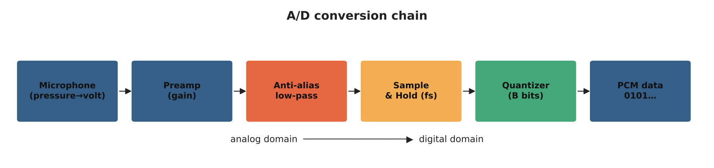
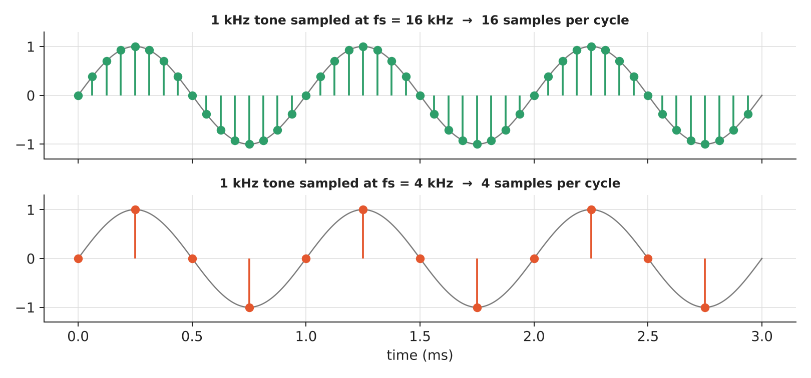
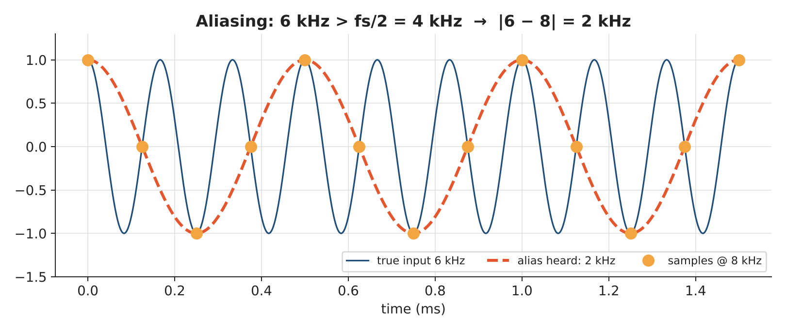
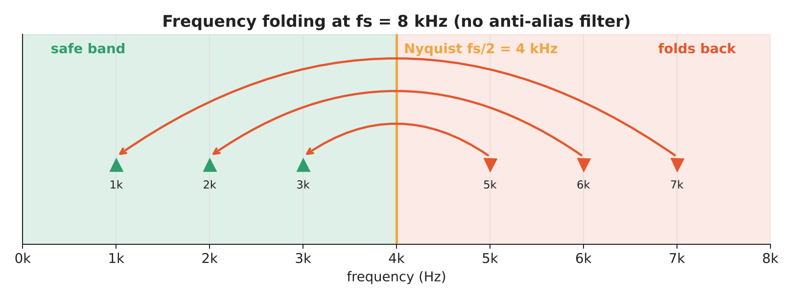
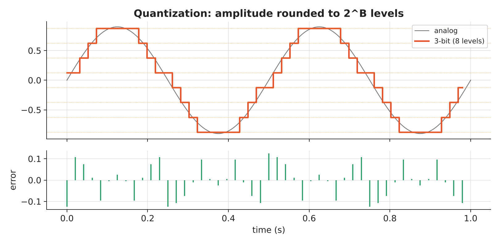
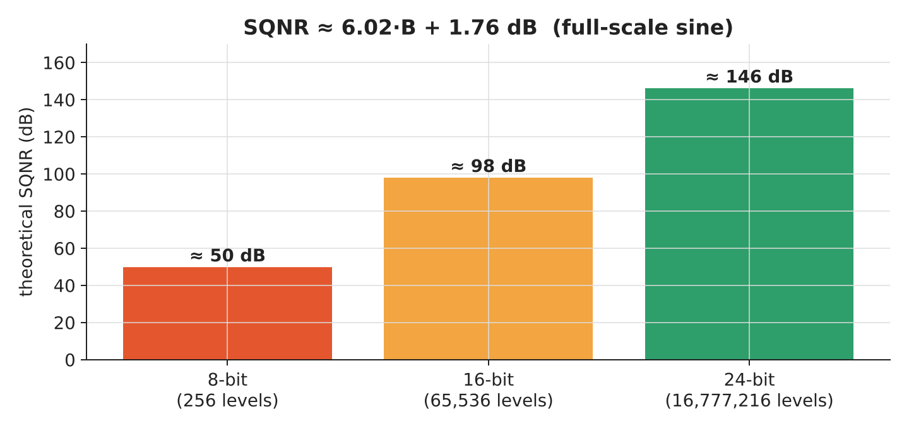
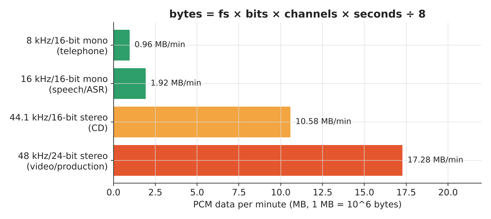

# สัปดาห์ที่ 2: การแปลงสัญญาณแอนะล็อกเป็นดิจิทัล

*Analog-to-Digital Conversion: Sampling, Quantization and PCM*

**เอกสารประกอบการสอน IMS2003 การประมวลผลเสียงและสุนทรียศาสตร์ด้านมัลติมีเดีย**

- หลักสูตรวิทยาศาสตรบัณฑิต สาขาวิชาวิทยาการมัลติมีเดียปัญญาประดิษฐ์ พ.ศ. 2569
- วิชาแกน 3(2-2-5) · ชั้นปีที่ 2 ภาคปลาย
- อาจารย์ ดร.เขมวิทย์ จิตตะยโศธร
- คณะเทคโนโลยีสารสนเทศ มหาวิทยาลัยราชภัฏร้อยเอ็ด

---

## แผนบริหารการสอนประจำสัปดาห์ที่ 2

| รายการ | รายละเอียด |
| --- | --- |
| รหัสและชื่อวิชา | IMS2003 การประมวลผลเสียงและสุนทรียศาสตร์ด้านมัลติมีเดีย (Audio and Speech Processing in Multimedia) |
| หัวข้อ | การแปลงสัญญาณแอนะล็อกเป็นดิจิทัล (A/D Conversion) |
| เวลาเรียน | ทฤษฎี 2 ชั่วโมง · ปฏิบัติ 2 ชั่วโมง · ศึกษาด้วยตนเอง 5 ชั่วโมง |
| CLO / PLO ที่เกี่ยวข้อง | CLO1 อธิบายฟิสิกส์ของเสียง A/D conversion และหลัก DSP พร้อมอ่านหลักฐานจากกราฟได้ (PLO1) |
| ความรู้พื้นฐาน | สัปดาห์ที่ 1: ความถี่ คาบ แอมพลิจูด เดซิเบล ช่วงการได้ยิน 20 Hz – 20 kHz · เลขฐานสองและเลขยกกำลัง |
| ซอฟต์แวร์ | Audacity 3.7.x · Google Colab (Python, numpy, matplotlib) · หูฟัง |

### หัวข้อเนื้อหา

1. 2.1 บทนำ — จากความดันในอากาศสู่ตัวเลขในไฟล์
2. 2.2 สายโซ่การแปลง A/D — ไมโครโฟน ปรีแอมป์ ตัวกรองกันเอเลียส สุ่มตัวอย่าง ควอนไทซ์
3. 2.3 การสุ่มตัวอย่าง — sample rate, ทฤษฎีบทไนควิสต์, aliasing และการ resample
4. 2.4 การควอนไทซ์ — bit depth, ความคลาดเคลื่อนจากการควอนไทซ์, dBFS, headroom, clipping, dither
5. 2.5 PCM รูปแบบไฟล์ และการคำนวณขนาดข้อมูล
6. 2.6 การเลือกสเปกให้เหมาะกับงาน
7. 2.7 การใช้ Generative AI และจริยธรรมข้อมูลเสียง

### จุดประสงค์การเรียนการสอน

#### จุดประสงค์ทั่วไป

เพื่อให้นักศึกษาเข้าใจกระบวนการแปลงสัญญาณเสียงแอนะล็อกเป็นข้อมูลดิจิทัล สามารถเลือก sample rate และ bit depth ให้เหมาะกับงาน คำนวณขนาดข้อมูล และอธิบายสาเหตุและการป้องกัน aliasing ได้

#### จุดประสงค์เชิงพฤติกรรม (ผลลัพธ์การเรียนรู้ตามระดับ Bloom)

| LO | เมื่อจบสัปดาห์ นักศึกษาสามารถ… | ระดับ Bloom |
| --- | --- | --- |
| LO1 | บอกความหมายของ sample rate, bit depth, ความถี่ไนควิสต์, PCM และ dBFS ได้ | จำ (Remember) |
| LO2 | อธิบายสาเหตุของ aliasing และบทบาทของตัวกรองกันเอเลียสได้ | เข้าใจ (Understand) |
| LO3 | คำนวณคาบการสุ่ม ความถี่เอเลียส จำนวนระดับควอนไทซ์ SQNR และขนาดไฟล์ PCM ได้ | ประยุกต์ (Apply) |
| LO4 | เปรียบเทียบไฟล์เสียงพูด 48 kHz กับ 16 kHz จากการฟังและภาพสเปกตรัม แล้วระบุสิ่งที่หายไปได้ | วิเคราะห์ (Analyze) |
| LO5 | ตัดสินเลือกสเปกการบันทึก (fs / bit / ช่อง / รูปแบบไฟล์) สำหรับงานมัลติมีเดียแต่ละประเภทพร้อมเหตุผลได้ | ประเมิน (Evaluate) |
| LO6 | สร้างการจำลอง aliasing ด้วย Python หรือ Audacity พร้อมกราฟและคำอธิบายได้ | สร้างสรรค์ (Create) |

**ด้านคุณลักษณะ:** รับผิดชอบงาน · เคารพสิทธิ์และความเป็นส่วนตัวของเจ้าของเสียง · ซื่อสัตย์ในการรายงานผลและการใช้ AI · ทำงานกลุ่มและนำเสนอผลได้

### วิธีสอนและกิจกรรมการเรียนการสอน

| เวลา (นาที) | กิจกรรม | สื่อ/หลักฐาน |
| --- | --- | --- |
| 10 | ทบทวนสัปดาห์ที่ 1 + แบบทดสอบก่อนเรียน (10 ข้อ) | แบบทดสอบก่อนเรียน |
| 10 | กิจกรรมที่ 1 “ล้อรถย้อนหลัง” — aliasing ที่ตาเห็นได้ | คลิปวิดีโอล้อรถ/ใบพัด |
| 30 | บรรยาย 2.2–2.3 สายโซ่ A/D, sampling, Nyquist, aliasing | สไลด์ 4–11 · ตัวอย่างที่ 2.1–2.2 |
| 10 | กิจกรรมที่ 2 “พับความถี่” คำนวณเอเลียสบนกระดาน | แบบฝึกคำนวณ |
| 30 | บรรยาย 2.4–2.6 quantization, dBFS, PCM, ขนาดไฟล์, การเลือกสเปก | สไลด์ 12–18 · ตัวอย่างที่ 2.3–2.5 |
| 15 | กิจกรรมที่ 3 ฟัง 48 kHz vs 16 kHz vs 8 kHz ของเสียงพูดและแคน | ใบบันทึกการฟัง |
| 15 | สรุป มอบหมายงาน แบบทดสอบหลังเรียน | สไลด์ 19–20 |

**คาบปฏิบัติ (120 นาที):** ใบงานปฏิบัติการที่ 2 “Resample, ขนาดไฟล์ และการจำลอง Aliasing” (ไฟล์ `IMS2003_W02_Workshop.md`)

### สื่อการเรียนการสอน

- เอกสารประกอบการสอนสัปดาห์ที่ 2 และสไลด์บรรยาย
- ไฟล์เสียงพูด WAV 48 kHz/24-bit ที่บันทึกด้วยความยินยอม และไฟล์เสียงแคนจากสัปดาห์ที่ 1
- Audacity 3.7.x และ Google Colab
- ใบงานปฏิบัติการที่ 2 บน GitHub ของรายวิชา
- แบบทดสอบก่อน–หลังเรียน และแบบฝึกหัดท้ายบท

### การวัดผลและประเมินผล

- สังเกตการมีส่วนร่วมและการตอบคำถาม
- แบบทดสอบก่อนเรียนและหลังเรียน
- แบบฝึกหัดท้ายบท
- ชิ้นงานจากใบงานปฏิบัติการที่ 2 ตามเกณฑ์ท้ายเอกสาร

## แบบทดสอบก่อนเรียน สัปดาห์ที่ 2

**คำชี้แจง** เลือกคำตอบที่ถูกต้องที่สุดเพียงข้อเดียว (10 ข้อ 10 คะแนน เวลา 10 นาที)

**1. Sample rate หมายถึงข้อใด**

- ก. จำนวนบิตที่ใช้เก็บแต่ละตัวอย่าง
- ข. จำนวนช่องสัญญาณของไฟล์
- ค. จำนวนตัวอย่างสัญญาณที่วัดต่อวินาที
- ง. ความดังสูงสุดของไฟล์

**2. ไฟล์ที่ sample rate 48 kHz มีความถี่ไนควิสต์เท่าใด**

- ก. 24 kHz
- ข. 48 kHz
- ค. 96 kHz
- ง. 12 kHz

**3. PCM ความละเอียด 16 บิต แทนค่าแอมพลิจูดได้กี่ระดับ**

- ก. 16
- ข. 256
- ค. 1,048,576
- ง. 65,536

**4. Aliasing คือปรากฏการณ์ใด**

- ก. เสียงดังเกินจนถูกตัดยอด
- ข. ความถี่ที่สูงกว่าครึ่งหนึ่งของ sample rate ปรากฏเป็นความถี่ต่ำปลอม
- ค. เสียงสะท้อนในห้อง
- ง. การบีบอัดไฟล์จนคุณภาพลด

**5. อุปกรณ์ใดใช้ลดความเสี่ยง aliasing ก่อนการสุ่มตัวอย่าง**

- ก. ตัวกรองความถี่ต่ำผ่าน (low-pass filter)
- ข. ตัวกรองความถี่สูงผ่าน (high-pass filter)
- ค. คอมเพรสเซอร์
- ง. รีเวิร์บ

**6. สเปกมาตรฐานของ Audio CD คือข้อใด**

- ก. 48 kHz / 24 บิต / โมโน
- ข. 8 kHz / 8 บิต / โมโน
- ค. 44.1 kHz / 16 บิต / สเตอริโอ
- ง. 96 kHz / 32 บิต / สเตอริโอ

**7. 0 dBFS หมายถึงข้อใด**

- ก. ความเงียบสนิท
- ข. ระดับสูงสุดที่ระบบดิจิทัลแทนค่าได้
- ค. ระดับความดันเสียงอ้างอิง 20 µPa
- ง. ระดับเฉลี่ยของเสียงพูด

**8. การเพิ่ม bit depth มีผลโดยตรงต่อสิ่งใดมากที่สุด**

- ก. ความถี่สูงสุดที่บันทึกได้
- ข. ความยาวของไฟล์เป็นวินาที
- ค. จำนวนช่องสัญญาณ
- ง. ช่วงไดนามิกและระดับสัญญาณรบกวนจากการควอนไทซ์

**9. ไฟล์ WAV ทั่วไปเก็บข้อมูลเสียงในรูปแบบใด**

- ก. MP3 แบบสูญเสียข้อมูล
- ข. MIDI
- ค. PCM แบบไม่บีบอัด
- ง. ภาพสเปกโทรแกรม

**10. ระบบรู้จำเสียงพูด (ASR) หลายระบบ เช่น Whisper ประมวลผลเสียงที่ sample rate ใด**

- ก. 16 kHz
- ข. 4 kHz
- ค. 192 kHz
- ง. 1 MHz

## บทที่ 2 การแปลงสัญญาณแอนะล็อกเป็นดิจิทัล

### 2.1 บทนำ

สัปดาห์ที่ 1 เราเห็นว่าเสียงคือความดันที่แปรผันอย่าง **ต่อเนื่อง** ทั้งในเวลาและในขนาด แต่คอมพิวเตอร์เก็บได้เฉพาะ **ตัวเลขจำนวนจำกัด** การแปลงสัญญาณแอนะล็อกเป็นดิจิทัล (Analog-to-Digital Conversion: A/D หรือ ADC) จึงต้องตัดสินใจสองเรื่อง คือ วัดค่า **บ่อยแค่ไหน** (sample rate) และเก็บค่าที่วัด **ละเอียดแค่ไหน** (bit depth) การตัดสินใจทั้งสองนี้กำหนดคุณภาพ ขนาดไฟล์ และความเหมาะสมกับงานปลายทาง ตั้งแต่เกม ภาพยนตร์ จนถึงโมเดล AI ด้านเสียงพูด

> [!NOTE]
> **🎯 โจทย์เดินเรื่อง “คลังเสียงอีสานดิจิทัล” ตอนที่ 2**
>
> ทีมพร้อมออกไปบันทึกเสียงแคน พิณ และเสียงพูดภาษาอีสาน แต่เจอคำถาม 3 ข้อ:
>
> ① โทรศัพท์บันทึกได้ 48 kHz/24-bit แต่ระบบถอดความ (ASR) ที่จะใช้รับ 16 kHz — ควรบันทึกที่ค่าใด แล้วแปลงเมื่อไร
>
> ② เซิร์ฟเวอร์เกมมีพื้นที่จำกัด เสียงประกอบเกม 300 คลิป คลิปละ 3 วินาที ใช้พื้นที่เท่าใดในแต่ละสเปก
>
> ③ ทำไมเพื่อนที่ลด sample rate ด้วยการ “ข้ามตัวอย่าง” เองในโค้ด จึงได้ยินเสียงแปลก ๆ ที่ไม่มีในต้นฉบับ
>
> ท้ายบทนักศึกษาต้องตอบทั้งสามข้อได้ด้วยหลักฐานและการคำนวณ

### 2.2 สายโซ่การแปลง A/D

<p align="center"></p>

<p align="center"><b>รูปที่ 2.1 สายโซ่การแปลงเสียงจากความดันอากาศเป็นข้อมูล PCM</b></p>

| ขั้น | หน้าที่ | ถ้าตั้งค่าผิด |
| --- | --- | --- |
| ไมโครโฟน (transducer) | แปลงการแปรผันของความดันเป็นแรงดันไฟฟ้าขนาดเล็ก | ตำแหน่ง/ระยะผิด ได้เสียงห้องมากหรือลมปะทะ (สัปดาห์ที่ 5) |
| ปรีแอมป์ (gain) | ขยายสัญญาณให้อยู่ในช่วงที่ตัวแปลงรับได้ | gain สูงเกิน → clipping · ต่ำเกิน → เสียงรบกวนเด่น |
| ตัวกรองกันเอเลียส (anti-aliasing LPF) | ลดความถี่ที่สูงกว่า fs/2 ก่อนสุ่มตัวอย่าง | ไม่มีตัวกรอง → ความถี่สูงพับกลับเป็นเสียงปลอม |
| สุ่มตัวอย่าง (sample & hold) | วัดค่าแรงดันทุกช่วงเวลา Ts = 1/fs | fs ต่ำเกินไป → เสียงขาดย่านสูง |
| ควอนไทซ์ (quantizer) | ปัดค่าที่วัดเป็นระดับจำกัด 2^B ระดับ แล้วเข้ารหัสเป็นเลขฐานสอง | บิตน้อยเกิน → เสียงรบกวนจากการควอนไทซ์ |

ในตัวแปลงสัญญาณเสียงสมัยใหม่ (เช่น ชิปในอินเทอร์เฟซเสียงและโทรศัพท์) งานบางส่วนถูกย้ายไปทำในโดเมนดิจิทัล โดยสุ่มที่อัตราสูงกว่าที่ต้องการมาก (oversampling) แล้วกรองและลดอัตราด้วยตัวกรองดิจิทัล แต่หลักการที่ผู้ใช้ต้องเข้าใจยังเหมือนเดิม: **ต้องจำกัดแบนด์ให้ต่ำกว่า fs/2 ก่อนเก็บที่อัตรานั้น**

### 2.3 การสุ่มตัวอย่าง (Sampling)

#### 2.3.1 Sample rate และคาบการสุ่ม

**Sample rate (fs)** คือจำนวนครั้งที่วัดค่าสัญญาณต่อวินาที หน่วย Hz หรือ samples/s ช่วงเวลาระหว่างตัวอย่างเรียกว่า **คาบการสุ่ม (sampling period, Ts)** ซึ่งเป็นแนวคิดเดียวกับ T = 1/f ในสัปดาห์ที่ 1

> **สูตรและตัวอย่างที่ 2.1**
>
> Ts = 1 / fs
>
> fs = 48,000 Hz → Ts = 1/48,000 ≈ 20.83 µs
>
> fs = 16,000 Hz → Ts = 62.5 µs
>
> โทน 1 kHz (คาบ 1 ms) ที่ fs = 48 kHz จึงถูกวัด 48 ครั้งต่อรอบ แต่ที่ fs = 4 kHz เหลือเพียง 4 ครั้งต่อรอบ (รูปที่ 2.2)

<p align="center"></p>

<p align="center"><b>รูปที่ 2.2 โทน 1 kHz ที่สุ่มด้วย fs = 16 kHz (บน) และ fs = 4 kHz (ล่าง)</b></p>

#### 2.3.2 ทฤษฎีบทการสุ่มตัวอย่างของไนควิสต์–แชนนอน

ทฤษฎีบทการสุ่มตัวอย่าง (Nyquist–Shannon sampling theorem) กล่าวว่า สัญญาณที่มีองค์ประกอบความถี่สูงสุดไม่เกิน f_max จะถูกสร้างคืนได้สมบูรณ์จากตัวอย่าง หาก fs มากกว่า 2·f_max ความถี่ครึ่งหนึ่งของ sample rate เรียกว่า **ความถี่ไนควิสต์ (Nyquist frequency)** f_N = fs/2 ซึ่งเป็น “เพดาน” ของความถี่ที่ไฟล์นั้นเก็บได้

> **สูตร**
>
> fs > 2 · f_max        f_N = fs / 2
>
> เชื่อมกับสัปดาห์ที่ 1: หูได้ยินถึงราว 20 kHz → ต้องใช้ fs มากกว่า 40 kHz → จึงเกิดมาตรฐาน 44.1 kHz และ 48 kHz ที่เผื่อพื้นที่ให้ตัวกรองทำงาน

#### 2.3.3 Aliasing

ถ้ามีความถี่ที่สูงกว่า f_N เข้าไปถึงขั้นสุ่มตัวอย่าง ตัวอย่างที่ได้จะ **เหมือนกันทุกประการ** กับตัวอย่างของความถี่ที่ต่ำกว่า ระบบจึงแยกไม่ออกและตีความเป็นความถี่ต่ำปลอม เรียกว่า **เอเลียส (alias)** เหมือนล้อรถในวิดีโอที่ดูเหมือนหมุนช้าหรือหมุนย้อนหลัง เพราะกล้องถ่ายภาพไม่ถี่พอ

<p align="center"></p>

<p align="center"><b>รูปที่ 2.3 โทน 6 kHz สุ่มที่ 8 kHz ตัวอย่างทุกจุด (วงกลม) ตรงกับโทน 2 kHz</b></p>

> **สูตรหาความถี่เอเลียส และตัวอย่างที่ 2.2**
>
> f_alias = | f − k·fs |   เลือกจำนวนเต็ม k ที่ทำให้ผลอยู่ในช่วง 0 ถึง fs/2
>
> fs = 8 kHz (f_N = 4 kHz):  5 kHz → 3 kHz · 6 kHz → 2 kHz · 7 kHz → 1 kHz · 9 kHz → |9 − 8| = 1 kHz
>
> fs = 44.1 kHz:  สัญญาณรบกวน 30 kHz จากอุปกรณ์ไฟฟ้า → |30 − 44.1| = 14.1 kHz ซึ่งอยู่ในย่านที่ได้ยิน
>
> ข้อสังเกต: เอเลียส “พับ” กลับรอบความถี่ไนควิสต์เหมือนกระจก (รูปที่ 2.4) และกำจัดภายหลังไม่ได้ เพราะปนอยู่ในย่านเดียวกับเสียงจริงแล้ว

<p align="center"></p>

<p align="center"><b>รูปที่ 2.4 การพับความถี่รอบ fs/2 เมื่อไม่มีตัวกรองกันเอเลียส</b></p>

#### 2.3.4 การ resample อย่างถูกวิธี

การเปลี่ยน sample rate ของไฟล์ที่บันทึกแล้ว (resampling) ก็ต้องเคารพหลักเดียวกัน การลดจาก 48 kHz เป็น 16 kHz ต้อง **กรองความถี่สูงกว่า 8 kHz ทิ้งก่อน** แล้วจึงลดจำนวนตัวอย่าง โปรแกรมอย่าง Audacity (Tracks → Resample) และไลบรารีมาตรฐาน เช่น `librosa.resample` หรือ `scipy.signal.resample_poly` ทำขั้นกรองนี้ให้อัตโนมัติ แต่ถ้าเขียนโค้ด “หยิบทุก ๆ 3 ตัวอย่าง” (`x[::3]`) เอง จะไม่มีการกรองและเกิด aliasing ทันที — นี่คือคำตอบของคำถามที่ ③ ในโจทย์เดินเรื่อง

#### 2.3.5 Sample rate ที่พบบ่อย

| fs | f_N | งานที่ใช้ |
| --- | --- | --- |
| 8 kHz | 4 kHz | โทรศัพท์แบบดั้งเดิม (narrowband) — พูดรู้เรื่องแต่เสียงอู้อี้ ส/ซ/ฟ แยกยาก |
| 16 kHz | 8 kHz | เสียงพูดแบบ wideband, VoIP, ชุดข้อมูลและโมเดล ASR จำนวนมาก (เช่น Whisper) |
| 44.1 kHz | 22.05 kHz | Audio CD และเพลงจำหน่ายทั่วไป |
| 48 kHz | 24 kHz | วิดีโอ ภาพยนตร์ ออกอากาศ เกม — ค่าเริ่มต้นของงานมัลติมีเดียในรายวิชานี้ |
| 96 kHz | 48 kHz | งานผลิตที่ต้องยืด/ปรับเสียงมาก (เช่น sound design ที่ลด pitch) และงานบันทึกต้นฉบับ |

### 2.4 การควอนไทซ์ (Quantization)

#### 2.4.1 Bit depth และจำนวนระดับ

หลังสุ่มตัวอย่าง ค่าที่วัดได้ยังเป็นจำนวนจริงต่อเนื่อง ตัวควอนไทซ์จะ **ปัด** แต่ละค่าไปยังระดับที่ใกล้ที่สุดจากทั้งหมด **2^B ระดับ** เมื่อ B คือ **bit depth** (รูปที่ 2.5 แสดงตัวอย่าง 3 บิต = 8 ระดับ)

<p align="center"></p>

<p align="center"><b>รูปที่ 2.5 การควอนไทซ์ 3 บิต (บน) และความคลาดเคลื่อนจากการปัดค่า (ล่าง)</b></p>

| Bit depth | จำนวนระดับ | SQNR ทางทฤษฎี | การใช้งาน |
| --- | --- | --- | --- |
| 8 บิต | 256 | ≈ 50 dB | เสียงเกมยุคเก่า เสียงเอฟเฟกต์ lo-fi |
| 16 บิต | 65,536 | ≈ 98 dB | Audio CD ไฟล์ส่งมอบทั่วไป ชุดข้อมูลเสียงพูด |
| 24 บิต | 16,777,216 | ≈ 146 dB | การบันทึกต้นฉบับ (ได้ headroom มาก) |
| 32 บิต float | ทศนิยมลอยตัว | ช่วงกว้างมาก | การประมวลผลภายใน DAW — ลดโอกาสตัดยอดระหว่างประมวลผล |

#### 2.4.2 ความคลาดเคลื่อนจากการควอนไทซ์และ SQNR

ผลต่างระหว่างค่าจริงกับค่าที่ปัดเรียกว่า **ความคลาดเคลื่อนจากการควอนไทซ์ (quantization error)** ซึ่งได้ยินเป็นเสียงรบกวนจาง ๆ อัตราส่วนสัญญาณต่อเสียงรบกวนจากการควอนไทซ์ (Signal-to-Quantization-Noise Ratio: SQNR) ของคลื่นไซน์เต็มสเกลมีค่าประมาณ

> **สูตรและตัวอย่างที่ 2.3**
>
> SQNR ≈ 6.02 · B + 1.76   dB
>
> 16 บิต: 6.02 × 16 + 1.76 = 98.08 dB · 24 บิต: 146.24 dB
>
> กฎจำง่าย: เพิ่ม 1 บิต → จำนวนระดับ ×2 → SQNR เพิ่มราว 6 dB (สอดคล้องกับ ×2 = +6 dB ในสัปดาห์ที่ 1)

<p align="center"></p>

<p align="center"><b>รูปที่ 2.6 SQNR ทางทฤษฎีตาม bit depth</b></p>

ค่า 98 dB หรือ 146 dB เป็นเพดานทางทฤษฎี ในทางปฏิบัติ เสียงรบกวนของไมโครโฟน ห้อง และวงจรแอนะล็อกมักสูงกว่าเสียงรบกวนจากการควอนไทซ์ของ 24 บิตมาก ข้อได้เปรียบหลักของการบันทึก 24 บิตจึงอยู่ที่ **ตั้ง gain ต่ำเผื่อ headroom ได้โดยไม่เสียความละเอียด**

#### 2.4.3 dBFS, headroom และ clipping

ในระบบดิจิทัลใช้หน่วย **dBFS (decibels relative to full scale)** โดย **0 dBFS คือค่าสูงสุดที่แทนได้** ระดับอื่นจึงเป็นค่าลบเสมอ เช่น ตัวอย่างที่มีค่า 0.5 ของสเกลเต็มอยู่ที่ 20·log₁₀(0.5) ≈ −6 dBFS สัญญาณที่พยายามเกิน 0 dBFS จะถูก **ตัดยอด (clipping)** กลายเป็นยอดแบน ได้ยินเป็นเสียงแตก และ **ลดระดับภายหลังก็ไม่คืนส่วนที่ถูกตัด** แนวปฏิบัติในการบันทึกเสียงพูดคือให้ยอดสูงสุดอยู่ราว −12 ถึง −6 dBFS เผื่อพื้นที่ (headroom) ไว้ ซึ่งจะฝึกจริงในสัปดาห์ที่ 5

> [!WARNING]
> **⚠️ อย่าสับสน dB SPL กับ dBFS**
>
> dB SPL (สัปดาห์ที่ 1) อ้างอิงความดัน 20 µPa ในอากาศ — ค่าบวก ยิ่งมากยิ่งดัง
>
> dBFS อ้างอิงค่าสูงสุดของระบบดิจิทัล — ค่าลบ 0 คือเพดาน ไม่มีความสัมพันธ์ตายตัวกับ dB SPL จนกว่าจะสอบเทียบระบบ

#### 2.4.4 Dither

เมื่อ **ลด bit depth** เช่น ส่งออกจาก 24 บิตเป็น 16 บิต ความคลาดเคลื่อนจากการปัดค่าของเสียงเบามาก ๆ (เช่น หางเสียงที่จางลง) จะสัมพันธ์กับสัญญาณและฟังเป็นความเพี้ยน การเติมสัญญาณรบกวนระดับต่ำมากที่เรียกว่า **dither** ก่อนปัด ช่วยเปลี่ยนความเพี้ยนนั้นเป็นเสียงรบกวนสม่ำเสมอที่ฟังเป็นธรรมชาติกว่า Audacity มีตัวเลือก dither ในหน้าตั้งค่าคุณภาพ (Preferences → Quality)

### 2.5 PCM รูปแบบไฟล์ และขนาดข้อมูล

#### 2.5.1 PCM

**Pulse-Code Modulation (PCM)** คือการเก็บตัวอย่างที่ควอนไทซ์แล้วเรียงต่อกันตามเวลาโดยไม่บีบอัด ไฟล์สเตอริโอจะเก็บตัวอย่างซ้าย–ขวาสลับกัน (interleaved) ไฟล์ WAV และ AIFF ส่วนใหญ่คือ PCM ที่มีส่วนหัวไฟล์ (header) บอกสเปก ดังนั้นขนาดไฟล์จริงจะมากกว่าข้อมูลเสียงเล็กน้อย

#### 2.5.2 การคำนวณอัตราข้อมูลและขนาดไฟล์

> **สูตร (ข้อมูลเสียง PCM ก่อนรวมส่วนหัวไฟล์)**
>
> อัตราข้อมูล (bit/s) = fs × B × ช่องสัญญาณ
>
> จำนวนไบต์ = fs × B × ช่องสัญญาณ × เวลา(s) ÷ 8

> **ตัวอย่างที่ 2.4 คำนวณตามโจทย์รายวิชา**
>
> 48,000 × 24 × 2 ÷ 8 = 288,000 ไบต์ต่อวินาที (= 2,304 kbit/s)
>
> เสียงพูด 10 วินาที 16 บิต โมโน:
>
>   • ที่ 48 kHz → 48,000 × 16 × 1 × 10 ÷ 8 = 960,000 ไบต์
>
>   • ที่ 16 kHz → 16,000 × 16 × 1 × 10 ÷ 8 = 320,000 ไบต์ (เล็กลง 3 เท่า เท่ากับอัตราส่วน fs)

<p align="center"></p>

<p align="center"><b>รูปที่ 2.7 ปริมาณข้อมูล PCM ต่อนาทีในสเปกที่พบบ่อย</b></p>

> **ตัวอย่างที่ 2.5 ตอบคำถาม ② ของโจทย์เดินเรื่อง**
>
> เสียงประกอบเกม 300 คลิป × 3 วินาที = 900 วินาที
>
> 48 kHz / 24 บิต / สเตอริโอ: 288,000 × 900 = 259,200,000 ไบต์ ≈ 259 MB
>
> 48 kHz / 16 บิต / โมโน: 96,000 × 900 = 86,400,000 ไบต์ ≈ 86 MB
>
> ข้อสรุป: เก็บต้นฉบับที่ 24 บิตไว้ในคลัง แต่ส่งมอบให้เกมเป็น 16 บิต และใช้โมโนสำหรับเสียงที่เอนจินเกมจะจัดตำแหน่งในพื้นที่เอง (สัปดาห์ที่ 11)

#### 2.5.3 Lossless และ Lossy

| รูปแบบ | ประเภท | ใช้เมื่อ |
| --- | --- | --- |
| WAV / AIFF | PCM ไม่บีบอัด | ต้นฉบับ งานตัดต่อ ส่งต่อระหว่างโปรแกรม |
| FLAC | บีบอัดแบบไม่สูญเสีย (lossless) | เก็บคลังเสียงให้เล็กลงโดยถอดกลับได้ตรงทุกตัวอย่าง |
| MP3 / AAC / Opus | บีบอัดแบบสูญเสีย (lossy) | เผยแพร่ สตรีม เว็บ — ไม่ควรใช้เป็นต้นฉบับสำหรับตัดต่อซ้ำ |

### 2.6 การเลือกสเปกให้เหมาะกับงาน

| งาน | บันทึก/เก็บต้นฉบับ | ส่งมอบ/ใช้งาน | เหตุผล |
| --- | --- | --- | --- |
| ชุดข้อมูลเสียงพูดสำหรับ ASR | 48 kHz / 24 บิต / โมโน WAV | resample เป็น 16 kHz / 16 บิต / โมโน ตอนเตรียมข้อมูล | เก็บต้นฉบับคุณภาพสูงไว้ แปลงด้วยตัวกรองที่ถูกต้องเมื่อจำเป็น |
| เสียงประกอบวิดีโอ/ภาพยนตร์ | 48 kHz / 24 บิต | 48 kHz / 24 บิต WAV | ตรงมาตรฐานวิดีโอ ไม่ต้องแปลง fs |
| เสียงประกอบเกม | 48 kHz / 24 บิต | 48 kHz / 16 บิต (หรือ Ogg/Opus ตามเอนจิน) | ประหยัดพื้นที่ คุณภาพยังเพียงพอ |
| เพลงเผยแพร่ออนไลน์ | 48 kHz / 24 บิต | ตามข้อกำหนดแพลตฟอร์ม | แพลตฟอร์มแปลง/บีบอัดเองอีกชั้น |

หลักทั่วไปคือ **บันทึกครั้งเดียวด้วยคุณภาพสูงพอ แล้วแปลงลงตามปลายทาง** เพราะแปลงลงทำได้ไม่ยาก แต่ข้อมูลที่ไม่ได้บันทึกไว้ตั้งแต่แรก (ย่านความถี่สูง ความละเอียด) จะสร้างคืนไม่ได้

### 2.7 การใช้ Generative AI อย่างมีวิจารณญาณ

บทนี้มีสูตรชัดเจนที่ตรวจสอบได้ จึงเหมาะกับการให้ AI ช่วยสร้างโค้ดจำลองสัญญาณ แล้วนักศึกษาตรวจผลด้วยการคำนวณเอง ข้อผิดพลาดที่ AI มักทำในหัวข้อนี้ เช่น สับสน bit กับ byte (ลืม ÷ 8) ใช้ `x[::n]` ลด sample rate โดยไม่กรอง หรือคิด SQNR ผิดสูตร

**ตัวอย่าง prompt: ให้ AI ช่วยจำลอง aliasing**

```text
เขียนโค้ด Python (numpy, matplotlib) จำลองการสุ่มโทนไซน์ 6 kHz
ด้วย sample rate 8 kHz โดยไม่มีตัวกรองกันเอเลียส
พล็อตสัญญาณต่อเนื่อง 6 kHz, จุดตัวอย่าง และโทน 2 kHz ซ้อนกันในช่วง 0–1.5 ms
แล้วอธิบายสั้น ๆ ว่าทำไมจุดตัวอย่างจึงตรงกับโทน 2 kHz
ห้ามใช้ข้อมูลเสียงจริงของบุคคลใด
```

**ตัวอย่าง prompt: ให้ AI ตรวจการคำนวณ (หลังจากคำนวณเองแล้ว)**

```text
ฉันคำนวณขนาดข้อมูล PCM ของเสียง 10 วินาที 16 บิต โมโน
ที่ 48 kHz ได้ 960,000 ไบต์ และที่ 16 kHz ได้ 320,000 ไบต์
ช่วยตรวจทีละขั้นว่าถูกหรือไม่ ถ้าผิดให้ชี้ว่าผิดขั้นไหน
```

### 2.8 จริยธรรม กฎหมาย และความซื่อสัตย์ทางวิชาการ

- เสียงพูดที่ระบุตัวบุคคลได้ถือเป็นข้อมูลส่วนบุคคลตามพระราชบัญญัติคุ้มครองข้อมูลส่วนบุคคล พ.ศ. 2562 (PDPA) การบันทึกและนำไปใช้ (รวมถึงส่งเข้าเครื่องมือ ASR บนคลาวด์) ต้องแจ้งวัตถุประสงค์และได้รับความยินยอมจากเจ้าของเสียง
- ในใบงานให้ใช้เสียงของตนเอง หรือเสียงที่ได้รับความยินยอมเป็นลายลักษณ์อักษร
- เก็บไฟล์ต้นฉบับแยกจากไฟล์ที่แปลงแล้ว และบันทึกสเปกและขั้นตอนแปลงทุกครั้ง (provenance) เพื่อให้ตรวจสอบย้อนหลังได้
- โค้ดหรือคำอธิบายที่ได้จาก AI ต้องระบุใน AI Log และนักศึกษาต้องอธิบายผลได้ด้วยตนเอง

### 2.9 สรุป

การแปลง A/D ประกอบด้วยการจำกัดแบนด์ การสุ่มตัวอย่างตามเวลา และการควอนไทซ์ตามขนาด Sample rate กำหนดเพดานความถี่ที่ fs/2 ความถี่ที่สูงกว่านั้นจะพับกลับเป็นเอเลียส จึงต้องกรองก่อนสุ่มและก่อน resample เสมอ Bit depth กำหนดจำนวนระดับ 2^B และ SQNR ≈ 6.02B + 1.76 dB ระดับดิจิทัลวัดเป็น dBFS โดย 0 dBFS คือเพดานที่เกินแล้วถูกตัดยอด ขนาดข้อมูล PCM = fs × B × ช่อง × เวลา ÷ 8 และหลักการเลือกสเปกคือบันทึกต้นฉบับคุณภาพสูงแล้วแปลงลงตามงาน สัปดาห์หน้าเราจะเปิด “แว่นขยาย” ดูองค์ประกอบความถี่ของไฟล์ดิจิทัลเหล่านี้ด้วย FFT และ spectrogram ซึ่งจะทำให้เห็นผลของ resample และ aliasing ได้ชัดเจนยิ่งขึ้น

## กิจกรรมในชั้นเรียน

| กิจกรรม | เวลา | รายละเอียด | ผลลัพธ์/หลักฐาน |
| --- | --- | --- | --- |
| 1. ล้อรถย้อนหลัง | 10 นาที | ดูคลิปล้อรถหรือใบพัดที่ดูเหมือนหมุนกลับ อภิปรายว่าเฟรมเรตของกล้องคือ “sample rate” ของภาพ | คำอธิบายกลุ่ม · LO2 |
| 2. พับความถี่ | 10 นาที | แต่ละกลุ่มได้การ์ดความถี่ (5, 7, 9, 11 kHz) และ fs = 8 kHz หาเอเลียสแล้ววางบนเส้นจำนวนหน้าห้อง | เส้นจำนวน · LO3 |
| 3. ฟังสามสเปก | 15 นาที | ฟังเสียงพูดและแคนที่ 48, 16, 8 kHz ที่ระดับเท่ากัน ระบุพยัญชนะ/รายละเอียดที่หายไป | ใบบันทึกการฟัง · LO4 |
| 4. คำนวณคลังเสียง | 10 นาที | คำนวณพื้นที่ของโจทย์ ② ในสเปกที่กลุ่มเลือกเอง แล้วเทียบกับเพื่อน | ตารางคำนวณ · LO3, LO5 |
| 5. Exit ticket | 5 นาที | ตอบ 1 ข้อ: ทำไม `x[::3]` จึงต่างจาก Tracks → Resample | แบบฟอร์มออนไลน์ |

## แบบฝึกหัดท้ายบทที่ 2

**คำชี้แจง** แสดงวิธีทำทุกข้อที่มีการคำนวณ 1 MB = 1,000,000 ไบต์

1. จงหาคาบการสุ่ม Ts ของ fs = 8 kHz, 44.1 kHz และ 96 kHz (ตอบหน่วย µs)
2. จงหาความถี่ไนควิสต์ของ fs = 16 kHz, 22.05 kHz และ 48 kHz
3. สุ่มสัญญาณที่ fs = 8 kHz โดยไม่มีตัวกรองกันเอเลียส ความถี่ 7 kHz, 9 kHz และ 11 kHz จะปรากฏเป็นความถี่ใด
4. ตัวแปลงขนาด 12 บิต แทนค่าได้กี่ระดับ และมี SQNR ทางทฤษฎีประมาณเท่าใด
5. จงคำนวณขนาดข้อมูล PCM ของเสียง 30 วินาที 48 kHz / 24 บิต / สเตอริโอ ทั้งหน่วยไบต์และ MB
6. จงหาอัตราข้อมูล (kbit/s) ของเสียง 16 kHz / 16 บิต / โมโน
7. เลือกสเปกบันทึกและส่งมอบสำหรับ (ก) สัมภาษณ์ผู้สูงอายุเพื่อทำคลังเสียงภาษาอีสานสำหรับ ASR (ข) เสียงฝีเท้าในเกมมือถือ (ค) เสียงบรรยายคลิปประชาสัมพันธ์ พร้อมเหตุผลข้อละ 2–3 บรรทัด
8. อธิบายว่าทำไมการลด sample rate ด้วย Tracks → Resample ใน Audacity จึงไม่เกิด aliasing แต่การใช้ `x[::3]` ใน Python เกิดได้

#### แบบฝึกหัดปฏิบัติ A — Spec Card (ศึกษาด้วยตนเอง)

เลือกไฟล์เสียง 3 ไฟล์จากโทรศัพท์หรือคอมพิวเตอร์ของตนเอง (เช่น ข้อความเสียง คลิปวิดีโอ เพลงที่ซื้อ) ตรวจสเปกด้วย Audacity หรือคุณสมบัติไฟล์ (fs, bit depth, ช่อง, รูปแบบ, bitrate) คำนวณขนาดข้อมูล PCM ที่ควรเป็น เทียบกับขนาดไฟล์จริง และอธิบายความต่าง

#### แบบฝึกหัดปฏิบัติ B — Alias Hunter (ทางเลือก)

ใน Google Colab สร้าง chirp (เสียงกวาดความถี่) 0–20 kHz ที่ fs = 48 kHz แล้วลดเป็น 16 kHz สองวิธี คือ `x[::3]` และ `scipy.signal.resample_poly(x, 1, 3)` ฟังและพล็อต spectrogram เปรียบเทียบ ระบุช่วงเวลาที่เกิดเอเลียส (เตรียมพื้นฐานสำหรับสัปดาห์ที่ 3)

## แบบทดสอบหลังเรียน สัปดาห์ที่ 2

**คำชี้แจง** เลือกคำตอบที่ถูกต้องที่สุดเพียงข้อเดียว (10 ข้อ 10 คะแนน เวลา 10 นาที)

**1. สุ่มโทน 6 kHz ด้วย fs = 8 kHz โดยไม่กรอง จะได้ยินความถี่ใด**

- ก. 6 kHz
- ข. 8 kHz
- ค. 2 kHz
- ง. 14 kHz

**2. ข้อมูล PCM ของเสียง 10 วินาที 16 kHz / 16 บิต / โมโน มีขนาดเท่าใด**

- ก. 320,000 ไบต์
- ข. 2,560,000 ไบต์
- ค. 160,000 ไบต์
- ง. 32,000 ไบต์

**3. SQNR ทางทฤษฎีของระบบ 24 บิตประมาณเท่าใด**

- ก. 24 dB
- ข. 98 dB
- ค. 192 dB
- ง. 146 dB

**4. ตามทฤษฎีบทไนควิสต์ หากต้องการเก็บองค์ประกอบถึง 20 kHz ต้องใช้ fs เท่าใด**

- ก. มากกว่า 10 kHz
- ข. มากกว่า 40 kHz
- ค. มากกว่า 20 kHz
- ง. เท่าใดก็ได้

**5. อัตราข้อมูลของ PCM 48 kHz / 24 บิต / สเตอริโอ คือข้อใด**

- ก. 288,000 ไบต์ต่อวินาที
- ข. 48,000 ไบต์ต่อวินาที
- ค. 144,000 ไบต์ต่อวินาที
- ง. 1,152,000 ไบต์ต่อวินาที

**6. Clipping ในระบบดิจิทัลเกิดเมื่อใด**

- ก. สัญญาณต่ำกว่า −60 dBFS
- ข. ใช้ sample rate สูงเกินไป
- ค. สัญญาณพยายามเกิน 0 dBFS แล้วถูกตัดยอด
- ง. บันทึกเป็นโมโน

**7. ขณะ resample จาก 48 kHz เป็น 16 kHz โปรแกรมที่ทำถูกต้องจะทำสิ่งใดก่อนลดจำนวนตัวอย่าง**

- ก. เพิ่ม gain 6 dB
- ข. กรองความถี่ที่สูงกว่า 8 kHz ออก
- ค. แปลงเป็นสเตอริโอ
- ง. เพิ่ม bit depth เป็น 32 บิต

**8. ตัวอย่างที่มีค่ายอด 0.5 ของสเกลเต็ม อยู่ที่ระดับประมาณเท่าใด**

- ก. +6 dBFS
- ข. −3 dBFS
- ค. −50 dBFS
- ง. −6 dBFS

**9. ควรใช้ dither ในกรณีใด**

- ก. เมื่อเพิ่ม sample rate
- ข. เมื่อบีบอัดเป็น FLAC
- ค. เมื่อลด bit depth เช่น จาก 24 เป็น 16 บิต
- ง. เมื่อเปลี่ยนจากสเตอริโอเป็นโมโน

**10. รูปแบบไฟล์ใดเป็นการบีบอัดแบบไม่สูญเสียข้อมูล**

- ก. FLAC
- ข. MP3
- ค. AAC
- ง. Opus

## เกณฑ์การประเมินชิ้นงานสัปดาห์ที่ 2

ใช้ประเมินชิ้นงานจากใบงานปฏิบัติการที่ 2 และแบบฝึกหัดปฏิบัติ A (คะแนนดิบรวม 24 คะแนน แปลงเป็น 10 คะแนนตามใบงาน)

| เกณฑ์ | 4 ดีมาก | 3 ดี | 2 พอใช้ | 1 ต้องปรับปรุง |
| --- | --- | --- | --- | --- |
| ความถูกต้องของการคำนวณ (ขนาดไฟล์ เอเลียส SQNR) | ถูกทุกค่า แสดงสูตรและหน่วยครบ | ผิดเล็กน้อย 1 ค่า | ผิดหลายค่าแต่ใช้สูตรถูก | ใช้สูตรผิด/ไม่แสดงวิธี |
| ตารางสเปกและหลักฐานไฟล์ | สเปกครบ (fs, bit, ช่อง, ขนาดจริง) และอธิบายส่วนหัวไฟล์ | ครบเกือบทั้งหมด | ขาดบางคอลัมน์ | ไม่มีตาราง |
| การจำลอง/อธิบาย aliasing | กราฟชัด มีแกนและคำอธิบาย แยกกรณีกรอง/ไม่กรองถูกต้อง | กราฟชัด คำอธิบายบางส่วน | กราฟไม่ชัดหรือสับสนกรณี | ไม่มี |
| การฟังและวิเคราะห์ 48 vs 16 kHz | ระบุรายละเอียดที่หายพร้อมเหตุผลเชิงไนควิสต์ | ระบุได้แต่เหตุผลไม่ครบ | บรรยายกว้าง ๆ | ไม่มี |
| การใช้ AI อย่างมีวิจารณญาณ | ตรวจโค้ด/คำตอบของ AI ด้วยการคำนวณเอง และชี้จุดที่แก้ | ตรวจบางส่วน | ใช้โดยไม่ตรวจ | คัดลอกโดยอธิบายไม่ได้ |
| จริยธรรมและเอกสาร (AI Log, ความยินยอม) | AI Log ครบ ใช้เสียงตนเอง/มีความยินยอม เก็บต้นฉบับแยก | ขาดเล็กน้อย | ขาดหลายรายการ | ใช้เสียงผู้อื่นโดยไม่ยินยอม |

**การให้น้ำหนักคะแนนสัปดาห์นี้:** ใบงานปฏิบัติการที่ 2 = 10 คะแนน · แบบฝึกหัดท้ายบท = 5 คะแนน · แบบทดสอบหลังเรียน = ใช้ติดตามพัฒนาการ

## เอกสารอ้างอิง

- Shannon, C. E. (1949). Communication in the presence of noise. *Proceedings of the IRE, 37*(1), 10–21.
- Pohlmann, K. C. (2011). *Principles of digital audio* (6th ed.). McGraw-Hill.
- Smith, S. W. (1997). *The scientist and engineer's guide to digital signal processing*. California Technical Publishing.
- Lyons, R. G. (2010). *Understanding digital signal processing* (3rd ed.). Prentice Hall.
- Radford, A., Kim, J. W., Xu, T., Brockman, G., McLeavey, C., & Sutskever, I. (2023). Robust speech recognition via large-scale weak supervision. *Proceedings of ICML 2023*.
- พระราชบัญญัติคุ้มครองข้อมูลส่วนบุคคล พ.ศ. 2562. (2562). *ราชกิจจานุเบกษา*.
- Audacity Team. (n.d.). *Audacity 3.7 reference manual*. https://manual.audacityteam.org/
- มหาวิทยาลัยราชภัฏร้อยเอ็ด. (2569). *IMS2003 Materials* (เอกสารรายวิชา). https://github.com/reru-subjects/audio-and-speech-processing-in-multimedia

### หมายเหตุสำหรับอาจารย์ผู้สอน

- เตรียมไฟล์เสียงพูดและแคนที่ 48/16/8 kHz (resample ด้วย Audacity) ปรับระดับให้เท่ากันสำหรับกิจกรรมที่ 3
- หากห้องปฏิบัติการไม่มีอินเทอร์เน็ตสำหรับ Colab ให้ใช้ตัวเลือก Audacity ในใบงาน (Generate → Tone ที่ project rate ต่ำ)
- เน้นย้ำความต่างของ dB SPL และ dBFS — เป็นจุดที่นักศึกษาสับสนบ่อยและจะใช้ต่อในสัปดาห์ที่ 5 และ 7
- ไฟล์เสียงจากใบงานนี้จะถูกใช้ต่อในสัปดาห์ที่ 3 (spectrogram) ให้นักศึกษาเก็บไว้ในโฟลเดอร์รายวิชา

---

<sub>IMS2003 Audio and Speech Processing in Multimedia · สัปดาห์ที่ 2 · คณะเทคโนโลยีสารสนเทศ มหาวิทยาลัยราชภัฏร้อยเอ็ด</sub>
